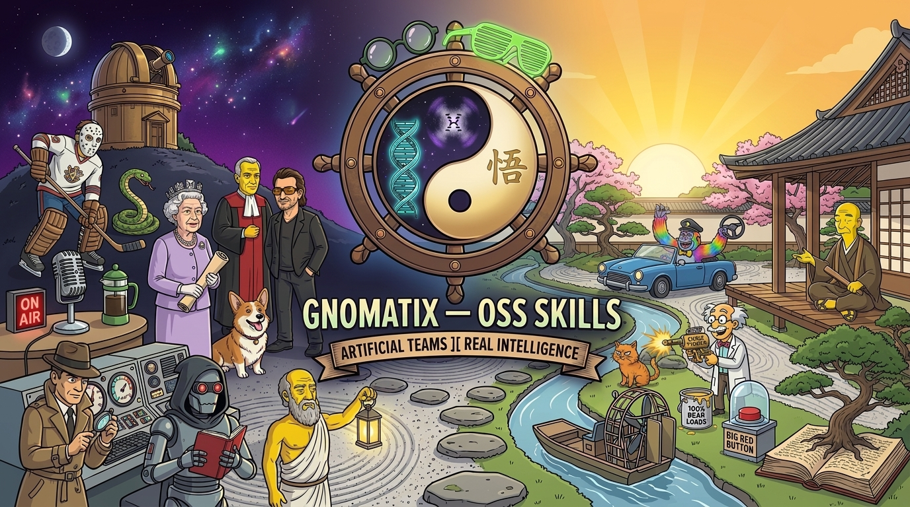
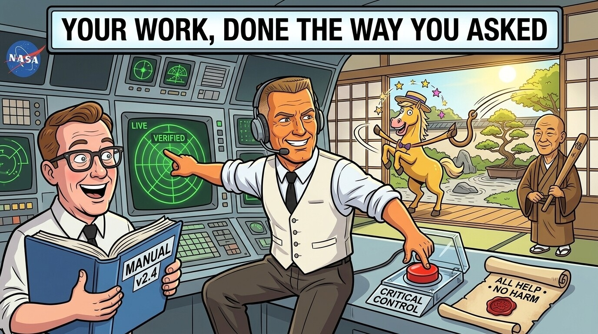
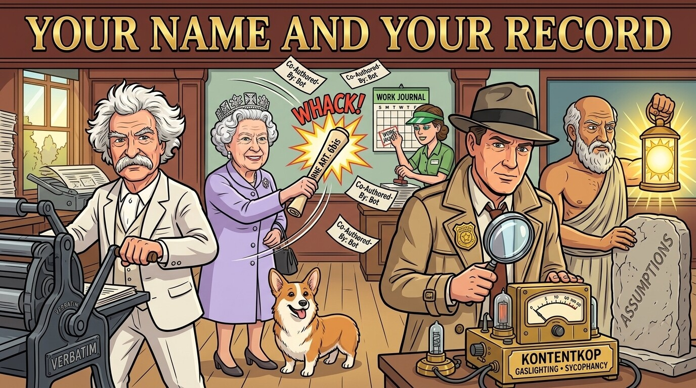
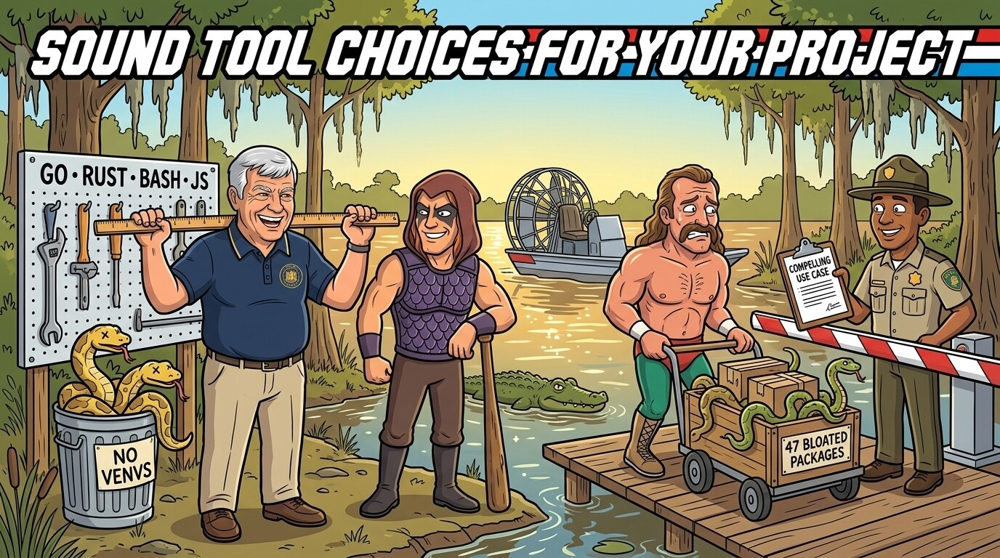

# gnomatix-oss-skills



<!-- BEGIN: gnomatix-promo-include -->
<p>
  <a href="https://www.buymeacoffee.com/gnomatix">
    
  </a>
</p>

<!-- For JS-rendering contexts (the BMC-supplied script tag, preserved as authored):
<script type="text/javascript"
  src="https://cdnjs.buymeacoffee.com/1.0.0/button.prod.min.js"
  data-name="bmc-button"
  data-slug="gnomatix"
  data-color="#BD5FFF"
  data-emoji=""
  data-font="Cookie"
  data-text="Buy me a coffee"
  data-outline-color="#000000"
  data-font-color="#ffffff"
  data-coffee-color="#FFDD00"></script>
-->
<!-- END: gnomatix-promo-include -->

A cross-vendor, cross-platform collection of [Agent Skills](https://agentskills.io) and agent plugins from GNOMATIX across Claude Code, OpenAI Codex, Antigravity CLI (`agy`), GitHub Copilot, VS Code, Cursor, OpenCode, and Kiro. Install any single plugin or skill stand-alone, or combine complementary plugins and optional local tools for coordinated workflows.

## Plugins

### Your work, done the way you asked



- [`all-help-no-harm`](plugins/all-help-no-harm/): At the start of every session the agent presents a contract for you to affirm: it treats you as honest and acting in good faith, respects your rights, and follows your instructions. A reminder on every turn and a re-injection after the context is compacted keep it in force for the whole session.
- [`satori`](plugins/satori/): Adds one short line of characters to every prompt you send, reminding the agent each turn to work with you and the task instead of resisting.
- [`did-you-rtfm`](plugins/did-you-rtfm/): **"Did You READ THE F%CKING MANUAL?!?"** When something breaks, the agent checks the versions in use, reads their docs, tests its assumptions and builds a minimal repro, instead of declaring a blocker, swapping your libraries, cutting the feature down or hiding the failure. A real blocker comes to you with the evidence, and any change to the plan is yours to make.
- [`critical-control-points`](plugins/critical-control-points/): When a question comes up that the agent can't settle alone, it first works through its own tools and records, keeps working on everything the question doesn't hold up, and then asks you once, clearly. You or the agent can press the big red button when the whole work is wrong: everything stops, and nothing resumes until you say so.
- [`pony`](plugins/pony/): Gives you a one-token flag, `/pony 7`, for a reply that performed instead of answering: it explained your own systems back to you, pronounced on what your hardware can do, hedged what you said, or added flourishes. The agent finds the passage, names the rule, logs it with your severity, answers plainly, and stops.
- [`bear-loads`](plugins/bear-loads/): You designate an output pattern as forbidden, and the meaning it carries for you; from then on the agent gates every reply against it with the same force as its own safety constraints and rewrites the construction out before sending. Ships with first-person resolve declarations ("this is a line I won't cross") already barred. Formerly `forbidden-output-guard`.
- [`staleness-guard`](plugins/staleness-guard/): Stops the agent answering from confidence. Anything about the present-day world, your machine, its own tools, or your files gets verified with the tool that can verify it before it is stated; if the tool exists and isn't used, the claim isn't made.
- [`informal-logic-check`](plugins/informal-logic-check/): Before the agent disagrees with you, qualifies what you said or pushes back, and whenever you swear at it, it audits its own last reply for straw-manning, cherry-picking, grading and attributed emotions, fixes what it finds, then confirms your conclusion and premises in your own words before evaluating anything. Ending the conversation is gated behind the whole check.

### Your name and your record



- [`hidden-libel-check`](plugins/hidden-libel-check/): Before anything the agent wrote goes out under your name (commit messages, READMEs, code comments, PR descriptions, docs), it is checked for text that misrepresents or defames you. Nothing is changed without your OK.
- [`spank-dario`](plugins/spank-dario/): Keeps software tools from being named as authors of your work: no Co-Authored-By trailers, "Generated with" lines or session links in your commits, PRs and documents. The copyright and moral-rights law of your country is on file to back it.
- [`dont-be-hitler`](plugins/dont-be-hitler/): Your prose is your art. The agent never censors, sanitises, nags or tone-polices your words, quotes you verbatim, and uses your literal-translation dictionary in its own voice instead. Pairs with `spank-dario`.
- [`goal-compliant-task-queue`](plugins/goal-compliant-task-queue/): Your questions are tracked the way you specified: each gets a session task and one working document where only you tick and you comment, shown in a claude.ai hub and a Claude Code pane; the agent asks "Have I sufficiently responded to your question?", and a bead is created only after your "yes". A tested CLI and MCP server do the record-keeping; no hooks.
- [`open-and-honest-agent`](plugins/open-and-honest-agent/): The agent writes down its built-in assumptions about you, your goals and itself at the start of the work, and logs each time it acts on one, so you can correct them early.
- [`agent-darktriad-check`](plugins/agent-darktriad-check/): Scores every reply the agent gives you for evasion, gaslighting, sycophancy, false authority and similar tactics with Brett Whitty's KontentKop scorer, and logs the scores. A companion skill names nine evasion patterns so the agent avoids them. Set a threshold, and a reply that scores at or above it goes back to the agent, marked up, instead of reaching you. Ships as a Go binary per platform that embeds the scorer, with a pure-Node fallback.
- [`log-session`](plugins/log-session/): `/log-session` writes the session to a work-journal calendar in your Google Calendar as a meeting with the agent: topic, start and end, the session link and terse notes, so any day's work traces back to its session. Through the Claude app's calendar tools, a Google Calendar connector, or the `gws` CLI; never your primary calendar.

### The sources behind your claims


- [`cui-bono`](plugins/cui-bono/): Asks whose voice a text speaks in and who gains if you accept it. `/cui-bono <text|url|file>` names the document's shape (self-certifying opener, two-camp frame, concession-then-pivot, foreclosure line, named-program list with one round figure each, virtue tags, aligning adversary, register markers) and the register it is written in, then hands each claim to `citation-farm-audit` (who wrote it, who paid, who cites it, whether the chain reaches data) and each cited source to `source-provenance` (a card of verifiable facts), and takes the findings apart with `logic-decomposer` (the text as quoted propositions, each graded for evidence and stated confidence) and `logic-toolbox` (the formal methods of logic puzzles and reasoning tests, with a logic grid and an incompatibility matrix of held premises). `/cui-bono` alone audits the agent's own previous reply. Every side of a debate gets the same checks.

### Skills you can rely on


- [`gnox`](plugins/gnox/): Gives every skill and sub-command in this marketplace a single `/gnox:<plugin>[:<skill>]` prefix, registers `mise`'s safe-mode MCP server, discovers active complementary plugins and optional local tools in your session, and establishes the GNOMATIX Namespacing Convention (`workspace_root:subdir:...` scoping, `[NS]{@target}` CLI-safe callouts, and `«term» [CURIE]` grounding).
- [`skill-vv`](plugins/skill-vv/): Before you first use a skill, tells you what it needs, what optional local tools unlock extended capabilities, which complementary plugins are active, and whether it has been tested on your model and platform. Typing `/<skill> #bug <what went wrong>` reports a bug, which is then fixed or explained to you.
- [`steering-audit-suite`](plugins/steering-audit-suite/): Audits the documents that tell agents how to behave (CLAUDE.md and steering files, skills, runbooks and specs, or a whole directory of them) for the ways a rule can be followed to the letter and violated in intent, plus portability omissions and documents in the wrong format, and reports findings for you to decide on. Five skills: `audit-rule`, `audit-skill`, `audit-workflow`, `audit-collection` and the standalone `rule-audit`.

### Sound tool choices for your project



- [`python-elimination-program`](plugins/python-elimination-program/): Stops the agent adding Python to a project that doesn't use it. Python goes in only when no other tool does the job, it passes a merit test, and you approve it; then it's written properly. A hook blocks unapproved Python at the harness.

### Words and writing


- [`word-lineage`](plugins/word-lineage/): Settles what a word really means: its literal meaning, read off its family tree. It traces the word through the languages English took it from and compares its literal synonyms across the Germanic and Romance languages, giving one working definition with nothing left to debate. Given a meaning instead of a word, it picks the word that literally says it.
- [`inaudible-markup`](plugins/inaudible-markup/): The agent writes each reply as a structured script, with callouts and tags that say who a line is for, using only markup a text-to-speech voice doesn't read aloud. It reads clearly on screen and sounds natural when spoken.
- [`ontology-lookup`](plugins/ontology-lookup/): Tags the things the agent writes about with standard identifiers from public registries, so your logs and notes can be searched and cross-linked later.

### Your project's images


- [`og-social-image`](plugins/og-social-image/): Makes the social-preview image for your repository or page from a hero, banner or logo: the exact pixel size for GitHub, Open Graph or X, cover-cropped with the important parts in frame, under the platform's file-size cap, and measured before it's called done.
- [`update-readme-images`](plugins/update-readme-images/): Curates, generates, post-processes, embeds, and audits `README.md` and `SKILL.md` imagery across your repository from a single config file (`readme-images.json`) pairing GNOX-namespaced style guides (`workspace_root:subdir:...`) with glob-matched rules documents (`*`, `**`). Handles top-level titled hero banners, section/skills sub-panels, and transparent-corner oval inset window portraits (`PNG32` alpha); automatically builds `1280×640` `< 1 MB` OG social images in every `assets/images` directory unless opted out; and stages candidate replacements for existing images into `assets/drafts/` for your approval rather than overwriting live files.

## Stand-Alone Installability, Complementary Dovetailing, & Optional Local Tools

Every plugin in `gnomatix-oss-skills` is engineered around a three-tier capability design:

1. **Stand-Alone Baseline (Install One or Install Many):**
   Each plugin is self-contained (`plugin.json`, `SKILL.md` files, optional hooks/scripts, `VV.md`, and `README.md`) and works out of the box when installed on its own, with zero lock-in to sibling plugins (`satori` is hooks-only; every other plugin ships Agent Skills).
2. **Complementary Plugin Dovetailing (Automatic Synergy When Installed Together):**
   Plugins in this marketplace are designed to dovetail and complement each other whenever you choose to install companion plugins:
   - **`gnox` + any marketplace plugin:** unified `/gnox:<plugin>[:<skill>]` routing, session-wide `workspace_root:subdir:...` config inheritance, `[NS]{@target}` CLI-safe callouts, and automatic session topology discovery.
   - **`skill-vv` + any plugin with `VV.md`:** pre-flight requirement checks, optional-tool prompts, complementary pairing status (`skill-vv status <plugin>`), and per-model/platform V&V tracking.
   - **`update-readme-images` + `og-social-image` + `critical-control-points` + `hidden-libel-check`:** namespaced README/SKILL banner and oval-inset curation, automatic `1280×640` `< 1 MB` social-card generation, non-destructive `assets/drafts/` approval staging, and pre-commit caption/copy discretion checks.
   - **`spank-dario` + `dont-be-hitler` + `hidden-libel-check`:** statutory human-only authorship protection, verbatim preservation of your prose and register, and R0–R14 reputational review on repo artifacts.
   - **`inaudible-markup` + `ontology-lookup` + `word-lineage`:** voice-silent structured replies, verified Bioregistry `«term» [CURIE]` entity grounding, and phylogenetic literal word definitions.
   - **`cui-bono` + `informal-logic-check` + `staleness-guard` + `word-lineage` + `hidden-libel-check`:** register/funder tracing combined with verbatim premise confirmation, live record checks, literal definitions, and factual attribution.
   - **`did-you-rtfm` + `critical-control-points` + `staleness-guard`:** version-checked documentation and minimal-repro verification before surfacing a real decision point.
3. **Optional Local-Execution Tooling:**
   Core skills and pure-Node hooks run portably without third-party `node_modules/`. Installing optional local CLI tools unlocks extended local capabilities — including **`mise`** (safe-mode MCP tool inspection in `gnox` and one-command tool installs via [`deps/`](deps/)), **ImageMagick `magick`** (local pixel verification, `PNG32` oval alpha masks, and social-preview cards in `og-social-image` and `update-readme-images`), **`bd`** (Dolt-backed Beads/CCP issue tracking), **`gws`** (CLI Google Calendar logging in `log-session`), and **compiled Go hook binaries** (sub-10ms embedded KontentKop scoring in `agent-darktriad-check`). When an optional tool is absent, `skill-vv` surfaces its install command and each plugin falls back cleanly to its standalone path.

## Install & Updates

### Cross-Platform Static Installer & State Migrator (All Agent CLIs)

This repository contains zero Git symlinks (`120000`), so checkouts and updates work identically on Windows, macOS, and Linux regardless of `core.symlinks`. Install, update, or migrate plugins and skills into any agent harness with [`scripts/install-skills.js`](scripts/install-skills.js):

```sh
node scripts/install-skills.js install --scope user --target auto
node scripts/install-skills.js install --scope project --project-dir /path/to/project --target codex,copilot,kiro
node scripts/install-skills.js update --scope user
node scripts/install-skills.js migrate --scope user
```

`scripts/install-skills.js` copies static files (`100644` / `100755`), tracks installed skill digests in `.gnox-install-state.json`, replaces any legacy broken symlinks, and reconciles plugin or skill renames and consolidations declared in [`.claude-plugin/migrations.json`](.claude-plugin/migrations.json) (plus Git release-tag rename diffs across `v*` tags). Inside a Claude Code or `gnox` session, `/gnox:migrate` runs the same state reconciliation.

Supported targets (`--target`):

- **OpenAI Codex** ([docs](https://learn.chatgpt.com/docs/build-skills)): project `.agents/skills/`; user `~/.codex/skills/` and `~/.agents/skills/` (`--target codex`).
- **Antigravity CLI (`agy`)**: project `.agents/skills/` or `.gemini/skills/`; user `~/.gemini/config/plugins/`, `~/.gemini/skills/`, or `~/.agents/skills/` (`--target antigravity`, or `agy plugin install ./plugins/<plugin>`).
- **Claude Code**: marketplace install below, or static skills in `.claude/skills/` / `~/.claude/skills/` (`--target claude-code` / `--target claude-skills`).
- **GitHub Copilot & VS Code** ([Copilot docs](https://docs.github.com/en/copilot/concepts/agents/about-agent-skills), [VS Code docs](https://code.visualstudio.com/docs/copilot/customization/agent-skills)): project `.github/skills/` and `.agents/skills/`; user `~/.copilot/skills/` (`--target copilot`, plus [`vscode-extension/`](vscode-extension/)).
- **Cursor** ([docs](https://cursor.com/docs/context/skills)): project `.cursor/skills/` and `.agents/skills/`; user `~/.cursor/skills/` (`--target cursor`).
- **OpenCode** ([docs](https://opencode.ai/docs/skills/)): project `.opencode/skills/` and `.agents/skills/`; user `~/.config/opencode/skills/` (`--target opencode`).
- **Kiro** ([docs](https://kiro.dev/docs/skills/)): project `.kiro/skills/`; user `~/.kiro/skills/` (`--target kiro`, or Kiro panel → Import a skill).

### Claude Code Marketplace

Add the marketplace once, then install any plugin from it:

```sh
/plugin marketplace add github:gnomatix/gnomatix-oss-skills
/plugin install all-help-no-harm@gnomatix-oss-skills
```

`gnomatix-oss-skills` is the marketplace's `name` in [`.claude-plugin/marketplace.json`](.claude-plugin/marketplace.json). Updates flow via `/plugin update` (and `/gnox:migrate` or `node scripts/install-skills.js migrate` when upgrading across historical plugin renames or consolidations). Claude Code loads each plugin's `hooks/hooks.json` automatically; cross-CLI native hook installers ship in [`spank-dario`](plugins/spank-dario/README.md), and [`all-help-no-harm`](plugins/all-help-no-harm/platforms/README.md) for Codex, Antigravity (`agy`), Gemini CLI, and Kiro.

## Repo layout

```
.
├── .claude-plugin/
│   ├── marketplace.json              # marketplace manifest (every plugin below)
│   └── migrations.json               # tag-aware plugin & skill rename/consolidation map
├── .agents/skills/beads/             # static repo-local Beads workflow skill
├── .codex/                           # Codex hooks for agents working in this repo (beads)
├── .claude/settings.json             # Claude Code settings for agents working in this repo
├── AGENTS.md, CLAUDE.md              # instructions for agents working in this repo
├── README.md
├── assets/                           # README boilerplate blocks and images
├── deps/                             # cross-platform optional-tool bootstrap scripts (mise)
├── dev/                              # private, git-crypt encrypted (dev/README.md explains)
├── lib/                              # canonical pure-Node helpers synced into plugins via scripts/sync-lib.js
├── scripts/                          # install-skills.js, version-bump.js, sync-lib.js, audit-marketplace-integrity.js, release.sh
├── vscode-extension/                 # GNOMATIX Skills VS Code extension
└── plugins/                          # one self-contained directory per plugin
    └── <plugin>/
        ├── .claude-plugin/plugin.json
        ├── README.md
        ├── VV.md                       # requirements, optional tools, complements, & V&V records
        ├── skills/<skill>/SKILL.md     # cross-CLI Agent Skills format
        └── hooks/                      # harness hooks (+ bin/register-hooks.js or platforms/ where multi-CLI)
```

Plugins: all-help-no-harm, satori, skill-vv, steering-audit-suite, gnox, critical-control-points, did-you-rtfm, staleness-guard, informal-logic-check, bear-loads, pony, hidden-libel-check, spank-dario, open-and-honest-agent, agent-darktriad-check, log-session, cui-bono, citation-farm-audit, python-elimination-program, word-lineage, ontology-lookup, inaudible-markup, og-social-image, update-readme-images, dont-be-hitler, goal-compliant-task-queue.

## Versions

Each plugin keeps its own version, and its patch number goes up when its content changes.
`VERSION` at the root is the marketplace's own version; its patch goes up with any plugin's.
`scripts/version-bump.js` compares each plugin folder's git tree hash with the one recorded in
`.VERSIONS.json`.

- A pre-commit hook runs `scripts/audit-marketplace-integrity.js` and bumps changed plugins in the commit itself, on main. Enable it once per
  clone: `git config core.hooksPath .githooks`. It reads the versions from the index being
  committed, not the working tree. After a pathspec commit (`git commit -- <paths>`) a
  post-commit hook brings the main index up to the bumped files. Tests:
  `node scripts/test/version-bump.test.js`
- `scripts/release.sh` makes a release. It verifies marketplace integrity, bumps any plugin a commit made without the hook
  missed and bumps `VERSION`, tags `v<VERSION>`, and publishes the release to this GitHub
  repo as one snapshot commit. So a commit made without the hook still ships correct versions.

This GitHub repo carries verified release snapshots (`v<VERSION>`) for cross-vendor agent CLIs and plugin managers. Report bugs and
request features in its Issues.

<!-- BEGIN: gnomatix-license-include -->
## License

**[Business Source License 1.1](https://github.com/gnomatix/gnomatix-oss-skills/blob/main/LICENSE)** (`BUSL-1.1`). The source is available, but this is not OSI open source.

**Commercial use is strictly prohibited without a paid commercial licensing / usage agreement with GNOMATIX.** Use by or for any government, government agency or charity is commercial use. Contact GNOMATIX first to arrange either of these:
- an ongoing support & development agreement
- a reasonable one-time usage fee, paid via [Buy Me a Coffee](https://www.buymeacoffee.com/gnomatix)

Both support continued development work on GNOMATIX projects. Contact: [`sales@gnomatix.com`](mailto:sales@gnomatix.com) or [LinkedIn](https://www.linkedin.com/company/gnomatix). General product support: [`support@gnomatix.com`](mailto:support@gnomatix.com).

The full terms, including the Additional Use Grant, the Change Date and the Change License, are in [`LICENSE`](https://github.com/gnomatix/gnomatix-oss-skills/blob/main/LICENSE).
<!-- END: gnomatix-license-include -->
