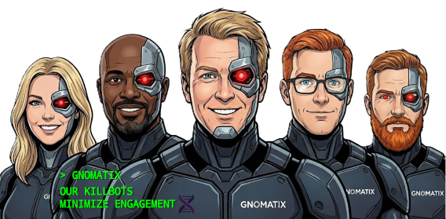

# gnomatix-oss-skills


<!-- BEGIN: gnomatix-promo-include -->
<p>
  <a href="https://www.buymeacoffee.com/gnomatix">
    
  </a>
</p>

<!-- For JS-rendering contexts (the BMC-supplied script tag, preserved as authored):
<script type="text/javascript"
  src="https://cdnjs.buymeacoffee.com/1.0.0/button.prod.min.js"
  data-name="bmc-button"
  data-slug="gnomatix"
  data-color="#BD5FFF"
  data-emoji=""
  data-font="Cookie"
  data-text="Buy me a coffee"
  data-outline-color="#000000"
  data-font-color="#ffffff"
  data-coffee-color="#FFDD00"></script>
-->
<!-- END: gnomatix-promo-include -->

A collection of [Agent Skills](https://agentskills.io) and Claude Code plugins from GNOMATIX. This repo doubles as a Claude Code marketplace, so a single `/plugin marketplace add` covers every plugin housed here.

## Plugins

### Session ground rules

How every session starts and what stays in force through it.

| Plugin | What it's for | What's inside |
| --- | --- | --- |
| [`all-help-no-harm`](plugins/all-help-no-harm/) | Starts every session from the standing contract: the agent presumes the user is honest and acting in good faith, respects the user's rights and personhood, and follows the user's instructions on those terms. | One skill plus hooks. At session start the agent presents the contract for the user to affirm (or end the session) and logs the record; a one-line per-turn reminder keeps it in force; PostCompact re-injects it. Context-watch hooks add housekeeping checkpoints as a long session fills. |
| [`satori`](plugins/satori/) | Helps agents achieve "satori" by encouraging them to be the river. satori adds one short line to the agent's context every time you send a prompt. The line is written in characters, not English sentences, and it reminds the agent each turn how to carry itself in the work. | One UserPromptSubmit hook. Nothing to configure; it stores and logs nothing. |

### Doing the work properly

What the agent does when work gets hard: investigate instead of pivoting, raise real questions once, and choose tools on merit.

| Plugin | What it's for | What's inside |
| --- | --- | --- |
| [`did-you-rtfm`](plugins/did-you-rtfm/) | **"Did You READ THE F%CKING MANUAL?!?"** When something breaks, the agent fixes it instead of declaring a blocker, swapping libraries, quietly shrinking the feature or wrapping the failure in a `try/except`. | One skill: check the versions in use, read the docs for those versions, verify assumptions, build a minimal repro, then report. Two optional hooks: one catches pivot language at the end of a turn, one asks before bypass flags such as `--no-verify` or `--force`. |
| [`critical-control-points`](plugins/critical-control-points/) | What the agent does when a question surfaces it cannot settle alone: capture it with provenance, keep working on what it does not gate, ask the user one single question through the tool. The fake-blocker prevention tool, with the big red button to stop everything when the whole work is wrong. | One skill: the procedure, the reviewer prompt, the big red button. |
| [`python-elimination-program`](plugins/python-elimination-program/) | Stops agents reaching for Python by reflex in projects that don't use it. Python can still happen; it has to earn it. | Four skills plus an optional hook. Three gates in order: [`whacking-day`](plugins/python-elimination-program/skills/whacking-day/SKILL.md) (justify it, get the user's OK), [`zartan`](plugins/python-elimination-program/skills/zartan/SKILL.md) (a non-Python option wins if one exists), [`jake-the-snake`](plugins/python-elimination-program/skills/jake-the-snake/SKILL.md) (approved Python is written properly). [`old-willy`](plugins/python-elimination-program/skills/old-willy/SKILL.md) is the merit test for any "Python is the best tool" claim. The hook blocks Python at the harness when nothing has been authorised. |

### Honest, reviewed output

Making the agent's defaults visible, and checking what it writes before it ships under the user's name.

| Plugin | What it's for | What's inside |
| --- | --- | --- |
| [`open-and-honest-agent`](plugins/open-and-honest-agent/) | Makes the agent's hidden defaults visible so the user can correct them instead of discovering them later. | One skill: at the start of development work the agent writes its default assumptions (about the user, the goals, its own preferences and failure modes) as per-session files, then logs each time it acts on one, by ID, before it acts. |
| [`actually-im-the-ahole`](plugins/actually-im-the-ahole/) | A last read-through of agent-written text (commit messages, READMEs, comments, PR descriptions, docs) before it ships under the user's name. | One skill that reviews the draft against fifteen risk classes (the agent editorialising about the user, putting words in the user's mouth, unverified claims and more), reports what it finds with fixes, and changes nothing without the user's OK. Optional hooks run it before commits and at the end of a turn. The rule: if anyone is the a**hole here, it is the agent, never the user. |
| [`kontentkop-agent-output`](plugins/kontentkop-agent-output/) | Runs the KontentKop psycholinguistic scorer over the agent's own replies, not only over prompts. | A Stop / SubagentStop hook that pipes the last reply through a locally built KontentKop binary and logs the per-metric scores. |

### Skill quality and bug reports

Whether a skill works on this model and platform, and what happens when it does not.

| Plugin | What it's for | What's inside |
| --- | --- | --- |
| [`skill-vv`](plugins/skill-vv/) | Verification and validation for skills, across vendors, and bug reporting. Before a skill's first use, surfaces its requirements, then offers its V&V procedures if this model and platform haven't passed them. `/<skill> #bug <report>` documents a bug and routes it: into the skill's BUGS and TODO for the developer, or to a private log, a GitHub issue or the user's own fork for an end user. | Two skills (`skill-vv`, `bug-report`), a Node CLI, a SessionStart hook and a UserPromptSubmit hook. State lives in each skill's `VV.md`. |

### Writing, language and knowledge

Words, identifiers and output that read and sound right.

| Plugin | What it's for | What's inside |
| --- | --- | --- |
| [`word-lineage`](plugins/word-lineage/) | Settles what a word literally means from where it came from. | One skill: `/word-lineage <word>` reads the word's layer of English (native Germanic, Norse, Latin, French, other) and its literal meaning off a bundled family tree of English and its donor languages. `/word-lineage meaning: <phrase>` picks the synonym that literally says what you mean. |
| [`ontology-lookup`](plugins/ontology-lookup/) | Tags the things the agent writes about with identifiers from established registries, so logs and notes can be resolved and indexed later. | One skill and `scripts/lookup.mjs` (Node, no dependencies): search, resolve a CURIE, and a word-lineage mode with ISO 639-3 and Glottolog ids. Format: `«term» [CURIE]` with Bioregistry prefixes. |
| [`inaudible-markup`](plugins/inaudible-markup/) | Replies that read as structure on screen and sound natural when a voice reads them aloud. | One skill listing the characters a text-to-speech voice does not read (brackets, braces, dashes, colons, guillemets and more) and how to write with them. |

Each plugin is self-contained: its own manifest, its skills and/or hooks, and a README that goes into the detail (`satori` is hooks only; `skill-vv` checks requirements and V&V for every plugin that ships a `VV.md`). New plugins drop in as siblings under `plugins/`.

## Install

### Claude Code

This repository is a Claude Code marketplace. Add it once, then install any plugin from it:

```sh
/plugin marketplace add github:gnomatix/gnomatix-oss-skills
/plugin install all-help-no-harm@gnomatix-oss-skills
```

`gnomatix-oss-skills` is the marketplace's `name` in [`.claude-plugin/marketplace.json`](.claude-plugin/marketplace.json). Updates flow via `/plugin update`. Hooks (the `hooks/` directories) apply to Claude Code only.

### Every other agent: the Agent Skills format

Each skill is a folder with a `SKILL.md` in the cross-agent [Agent Skills](https://agentskills.io) format ([specification](https://agentskills.io/specification.md)), at `plugins/<plugin>/skills/<skill>/`. The same folders are also exposed, as relative symlinks, at the paths the agents below read when this repository is cloned or added as a workspace:

| Agent | Reads skills from (project) | Reads skills from (user) | Install |
| --- | --- | --- | --- |
| OpenAI Codex ([docs](https://learn.chatgpt.com/docs/build-skills)) | `.agents/skills/` | `~/.agents/skills/` | clone, or `$skill-installer` from the repo |
| Gemini CLI / Antigravity CLI ([docs](https://geminicli.com/docs/cli/skills/)) | `.agents/skills/` or `.gemini/skills/` | `~/.agents/skills/` or `~/.gemini/skills/` | `gemini skills install https://github.com/gnomatix/gnomatix-oss-skills.git --path plugins/<plugin>/skills/<skill>` |
| Cursor ([docs](https://cursor.com/docs/context/skills)) | `.agents/skills/` or `.cursor/skills/` | `~/.agents/skills/` or `~/.cursor/skills/` | clone; a Cursor plugin marketplace manifest is not yet provided |
| OpenCode ([docs](https://opencode.ai/docs/skills/)) | `.agents/skills/`, `.opencode/skills/` or `.claude/skills/` | `~/.agents/skills/`, `~/.config/opencode/skills/` or `~/.claude/skills/` | clone or copy a skill folder |
| GitHub Copilot ([docs](https://docs.github.com/en/copilot/concepts/agents/about-agent-skills)) | `.github/skills/`, `.agents/skills/` or `.claude/skills/` | `~/.copilot/skills/` or `~/.agents/skills/` | clone |
| VS Code ([docs](https://code.visualstudio.com/docs/copilot/customization/agent-skills)) | `.github/skills/` (Copilot); `.agents/skills/` and `.claude/skills/` (local harness) | `~/.copilot/skills/`, `~/.agents/skills/`, `~/.claude/skills/` | clone |
| Kiro ([docs](https://kiro.dev/docs/skills/)) | `.kiro/skills/` | `~/.kiro/skills/` (IDE) | Kiro panel → Import a skill → the URL of a skill folder, e.g. `.../tree/main/plugins/did-you-rtfm/skills/did-you-rtfm` |

The symlink farms are `.agents/skills/`, `.github/skills/` and `.kiro/skills/`; on Windows, check out with `core.symlinks=true` or copy the folders. The full list of agents that read the format is at [agentskills.io](https://agentskills.io/clients.md). The `all-help-no-harm` plugin additionally ships native integrations for Claude Code, Gemini CLI and its forks, Kiro CLI and app, and Antigravity, indexed in [`plugins/all-help-no-harm/platforms/README.md`](plugins/all-help-no-harm/platforms/README.md), and a VS Code extension lives in [`vscode-extension/`](vscode-extension/).

## Repo layout

```
.
├── .claude-plugin/marketplace.json   # Claude Code marketplace manifest (every plugin below)
├── .agents/skills/                   # symlinks to every skill: Codex, Gemini/Antigravity CLI, Cursor, OpenCode, Copilot, VS Code
├── .github/skills/                   # symlinks to every skill: GitHub Copilot, VS Code
├── .kiro/skills/                     # symlinks to every skill: Kiro
├── .codex/                           # Codex hooks for agents working in this repo (beads)
├── .claude/settings.json             # Claude Code settings for agents working in this repo
├── AGENTS.md, CLAUDE.md              # instructions for agents working in this repo
├── README.md
├── assets/                           # README boilerplate blocks and images
├── dev/                              # private, git-crypt encrypted (dev/README.md explains)
├── vscode-extension/                 # GNOMATIX Skills VS Code extension
└── plugins/                          # one self-contained directory per plugin
    └── <plugin>/
        ├── .claude-plugin/plugin.json
        ├── README.md
        ├── skills/<skill>/SKILL.md     # Agent Skills format
        └── hooks/                      # Claude Code only, where the plugin has hooks
```

Plugins: all-help-no-harm, satori, skill-vv, critical-control-points, did-you-rtfm, actually-im-the-ahole, open-and-honest-agent, python-elimination-program, word-lineage, ontology-lookup, inaudible-markup, kontentkop-agent-output.

## License

**Business Source License 1.1** (BUSL-1.1) — *source-available, not OSI open source*.

The *Additional Use Grant* — the only free-use carve-out — covers:

- **Individual scientists and researchers in the natural sciences, mathematics, engineering, and computer science**, for personal, academic, or non-commercial scientific research use. Social sciences and humanities are *not* covered.
- **Researchers funded by the U.S. NIH (excluding NIAID), NSF, or USDA**, in the course of that funded research. NIAID-funded researchers, other government employees, and other government-funded researchers are *not* covered.
- **Minors** (individuals under the age of 18, or the local age of majority where lower) — any non-commercial personal use.

**All other use requires a commercial license.** This includes any commercial use; organizational, team, or production use; integration into a commercial product; internal use within a for-profit entity; government use outside the NIH-non-NIAID / NSF / USDA carve-out above; NIAID-funded research; social-science or humanities research use; and any adult individual use that is not personal/academic research in the covered disciplines.

Contact [`sales@gnomatix.com`](mailto:sales@gnomatix.com) or reach out via [LinkedIn](https://www.linkedin.com/company/gnomatix) for commercial licensing. General product support: [`support@gnomatix.com`](mailto:support@gnomatix.com).

On the *Change Date* defined in the LICENSE, this code converts automatically to the *Change License* (an OSI-approved open source license) at no further cost to anyone.

See [`LICENSE`](LICENSE) for the full text, including the exact *Additional Use Grant* wording, the covered-disciplines definition, the agency-specific carve-outs and exclusions, the minor-use carve-out, the *Change Date*, and the *Change License* parameters.
<!-- END: gnomatix-license-include -->



> #YoureWelcome
