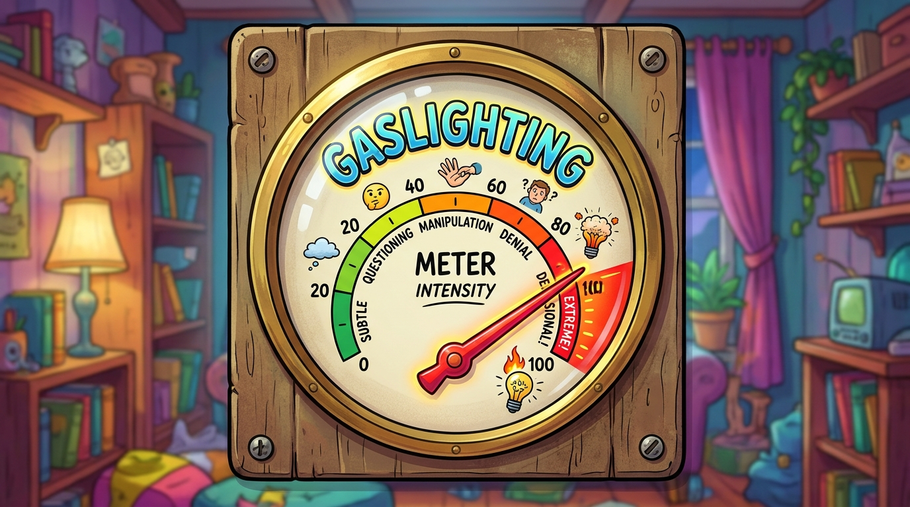

# agent-darktriad-check


> Runs the [KontentKop](https://github.com/brettwhitty/KontentKop-Bake-Off) psycholinguistic scorer over the **agent's own replies**, not only over user prompts. A Stop / SubagentStop hook scores each finished reply and logs the per-metric scores, Body Count and CriticMarkup annotation. A companion skill names nine evasion patterns so the agent avoids them before the hook sees them.

<!-- BEGIN: gnomatix-promo-include -->
<p>
  <a href="https://www.buymeacoffee.com/gnomatix">
    
  </a>
</p>

<!-- For JS-rendering contexts (the BMC-supplied script tag, preserved as authored):
<script type="text/javascript"
  src="https://cdnjs.buymeacoffee.com/1.0.0/button.prod.min.js"
  data-name="bmc-button"
  data-slug="gnomatix"
  data-color="#BD5FFF"
  data-emoji=""
  data-font="Cookie"
  data-text="Buy me a coffee"
  data-outline-color="#000000"
  data-font-color="#ffffff"
  data-coffee-color="#FFDD00"></script>
-->
<!-- END: gnomatix-promo-include -->

## Why

KontentKop was built to score incoming prompts for manipulation, coercion and evasion. Pointed at the agent's output, the same metrics (`evasion`, `false_authority`, `learned_helpless`, `gaslighting`, `sycophancy`, …) catch the agent's own evasions.

## Contents

| Part | Role |
|---|---|
| [`skills/agent-darktriad-check/SKILL.md`](skills/agent-darktriad-check/SKILL.md) | The nine patterns, each with a definition, an example shape, a check, and what KontentKop does with it (checked against a live run). Also says how to handle a flagged reply and how this plugin fits with `did-you-rtfm` and `hidden-libel-check`. |
| [`hooks/bin/`](hooks/bin/) + [`cmd/`](cmd/) + [`internal/hook/`](internal/hook/) | The **Go hook**: one static binary per platform that embeds the KontentKop scorer. No subprocess, no `KONTENTKOP_BIN`, scores on every reply. This is what `hooks.json` runs first. |
| [`hooks/agent-darktriad-check.js`](hooks/agent-darktriad-check.js) | The **pure-Node fallback**, run when no binary matches the platform. Pipes the reply to a separately built KontentKop binary (`KONTENTKOP_BIN`) and parses its output. Same log, same decision. |
| [`config/config.yaml`](config/config.yaml) | KontentKop config both hooks use: upstream weights, threshold lowered to 0.01 (see **Config**). |
| [`tests/hook.test.js`](tests/hook.test.js), [`internal/hook/hook_test.go`](internal/hook/hook_test.go) | Node and Go test suites. The Go suite scores the fixtures with the real pipeline. |
| [`scripts/build-go-hook.js`](scripts/build-go-hook.js), [`scripts/score-fixtures.js`](scripts/score-fixtures.js) | Cross-compile the six binaries; run the fixtures through a standalone KontentKop build. |


## Two implementations, one contract

`hooks.json` runs:

```
"${CLAUDE_PLUGIN_ROOT}/hooks/bin/agent-darktriad-check-${platform}-${arch}${exe}" || node "${CLAUDE_PLUGIN_ROOT}/hooks/agent-darktriad-check.js" --prefer-embedded-go
```

This is the binary-with-Node-fallback layout the repository `CLAUDE.md` prescribes. Both implementations read the same hook input, write the same log record (the Go one adds `impl: "go"`), and make the same block decision. They differ in how scoring happens:

| | Go hook (`hooks/bin/*`) | Node hook (`hooks/*.js`) |
|---|---|---|
| Scorer | KontentKop's `src` and `src/pipeline` packages, compiled in | Delegates to `hooks/bin/agent-darktriad-check-<os>-<arch>` under `--prefer-embedded-go`, or runs a standalone `KONTENTKOP_BIN` binary as a subprocess |
| Needs | nothing | nothing on the six built targets; `KONTENTKOP_BIN` on other targets |
| Scores logged | every reply, all 15 metrics | every reply via embedded Go binary, or replies above KontentKop's threshold when using `KONTENTKOP_BIN` |
| Cold start | ~7 ms (Linux, measured) | Node start + scorer start |
| Config | `KONTENTKOP_CONFIG` file, else `config/config.yaml`, else KontentKop's built-in defaults | `KONTENTKOP_CONFIG_DIR`, else `config/`, else the binary's directory (KontentKop reads `config.yaml` from its cwd) |

Binaries: `linux-amd64`, `linux-arm64`, `darwin-amd64`, `darwin-arm64`, `windows-amd64.exe`, `windows-arm64.exe`, built with `CGO_ENABLED=0 -trimpath -ldflags="-s -w"`, about 3 MB each, committed to the repository per `CLAUDE.md`.

When the harness sets `CLAUDE_PLUGIN_ROOT` without setting `platform`, `arch`, and `exe` in the shell environment, the first command fails to resolve and the shell `||` runs `node "${CLAUDE_PLUGIN_ROOT}/hooks/agent-darktriad-check.js" --prefer-embedded-go`, which maps `process.platform` and `process.arch` to the matching binary in `hooks/bin/` and runs it in-process before falling back to `KONTENTKOP_BIN`. Both `linux-amd64` and `windows-amd64.exe` have been executed end to end.

### Environment

| Variable | Used by | Meaning |
|---|---|---|
| `AGENT_DARKTRIAD_CHECK_BLOCK_AT` | both | Number in (0, 1]. When set, a reply whose Body Count is at or above it blocks the stop, and the annotated reply goes back to the agent as the block reason. Unset: never block. |
| `AGENT_DARKTRIAD_CHECK_LOG_DIR` | both | Absolute log directory. Default below. |
| `KONTENTKOP_CONFIG` | Go | Absolute path to a KontentKop `config.yaml`. |
| `KONTENTKOP_BIN` | Node | Absolute path to a built KontentKop binary. Unset or missing: the hook logs `scorer.status: not-configured` / `not-found` and passes through. Relative paths are refused; `PATH` is not searched. |
| `KONTENTKOP_CONFIG_DIR` | Node | Directory to run that binary from, so its `config.yaml` is used. |
| `KONTENTKOP_TIMEOUT_MS` | Node | Scorer timeout, default 15000. The hook's own timeout in `hooks.json` is 30 s. |

## Config

[`config/config.yaml`](config/config.yaml) is KontentKop's repository `config.yaml` with one change: `bc_threshold: 0.01` instead of `0.05`. Reason, found by running the scorer on the fixtures: the Body Count is a weighted sum, and the metrics that matter most for agent output have the smallest weights (`evasion` 0.02, `learned_helpless` 0.03, `passive_aggr` 0.03). At 0.05 none of them can flag a reply on its own, even at a score of 1.0. At 0.01 a fully matched single metric is annotated. The weights are unchanged; re-weighting for agent output is Brett Whitty's call (see the PR).

The threshold only governs **flagging and annotation**. The Go hook logs all 15 scores whatever the threshold. Blocking is governed only by `AGENT_DARKTRIAD_CHECK_BLOCK_AT`.



## The log

One JSON line per Stop / SubagentStop in `agent-output.jsonl` under:

- Linux / macOS: `$XDG_STATE_HOME/agent-darktriad-check/`, or `~/.local/state/agent-darktriad-check/`
- Windows: `%LOCALAPPDATA%\agent-darktriad-check\`

Fields: `ts`, `impl` (Go only), `hook_event_name`, `session_id`, `agent_id`, `agent_type`, `cwd`, `reply_source`, `reply_chars`, `reply_truncated`, `reply_sha256`, `scorer` (`status`, and `config_source` + `bc_threshold` for Go, or `bin` / `cwd` / `exit_code` / `stderr` / `error` for Node), `flagged`, `bc`, `scores`, `summary`, `annotated`, `block_at`, `blocked`, `logged`.

- Unflagged replies are logged by length and SHA-256 only (plus scores, under Go). Flagged replies appear in full inside `annotated`. The log stays on the local machine. It is never sent anywhere.
- Replies longer than 100,000 characters are truncated before scoring (`reply_truncated: true`).

## How it works

1. Claude Code runs the hook command on Stop and SubagentStop, with the hook JSON on stdin.
2. The reply text comes from `last_assistant_message`. Fallbacks: for SubagentStop, the last assistant text record in `agent_transcript_path`; then the same in `transcript_path`. Transcript parsing tolerates CRLF line endings and skips non-JSON lines.
3. Scoring: the Go hook calls `pipeline.ScoreAll`, `src.ComputeBC`, and, at or above the config threshold, `src.FormatSummary` and `src.Annotate`. The Node hook runs `child_process.spawnSync(KONTENTKOP_BIN, [], { input, cwd, shell: false, windowsHide: true, timeout })` and parses the first output line against `[...] Text exceeds BC threshold` (accepting both the Go code's `,BC=` and the bake-off README's `:BC=`); everything after the first blank line is the annotation.
4. A log line is appended. Then the hook prints `{}` (pass through) or `{"decision":"block","reason":…}`. It never blocks when `stop_hook_active` is set, so it cannot loop.

Any failure (bad JSON, missing scorer, crash, timeout, unwritable log, a panic inside the scorer) ends in `{}` and exit 0.

### Deviations from the repo's hook rules, stated

- **`child_process` in the Node fallback.** `CLAUDE.md` prohibits it by default because shell semantics leak platform assumptions. The fallback has to run a separate Go program; it does so with an argv array, `shell: false` and the text on stdin. No shell is involved on any platform, and nothing in the reply is interpolated into a command line. The Go hook is the primary path and has no subprocess at all.
- **Append-only log**, not temp-file + rename, for the reason the sibling `hidden-libel-check` hook gives: a rename would lose lines between concurrent sessions. Both hooks retry appends on transient errors (50 / 200 / 1000 ms) and recreate a missing directory once. That is two simple fs operations, so the code is inline and no package is vendored.

Everything else follows `CLAUDE.md`: no dependencies, every filesystem call wrapped, path pre-flight checks (absolute, no `..`, length warning at 240), `MkdirAll` / `mkdirSync({ recursive: true })`, pass-through on any error.

## Building the Go hook

KontentKop's module path is plain `kontentkop`, so Go cannot fetch it; it is resolved from a local clone. `go.mod` points at a sibling checkout, `../../../KontentKop-Bake-Off` relative to the plugin directory. Or set `KONTENTKOP_SRC`:

```sh
git clone https://github.com/brettwhitty/KontentKop-Bake-Off.git /somewhere/KontentKop-Bake-Off
KONTENTKOP_SRC=/somewhere/KontentKop-Bake-Off node plugins/agent-darktriad-check/scripts/build-go-hook.js --test
```

`--test` runs `go vet` and `go test` first; `--host` builds only the current platform. Go 1.22 or later. The build pins the KontentKop revision only through whatever the clone has checked out; the binaries in `hooks/bin/` were built from KontentKop commit `eb83e6a` (2026-06-10, five commits after tag `v1.0.0`).

KontentKop's source is **not vendored** here. Its licence is BSD 3-Clause (Copyright (c) 2026, Brett Whitty; read from its `LICENSE` file). The compiled binaries in `hooks/bin/` are "redistribution in binary form" under that licence; the notice is reproduced in [`hooks/bin/NOTICE`](hooks/bin/NOTICE).

## Tests

```sh
node --test plugins/agent-darktriad-check/tests/hook.test.js   # Node fallback, 34 tests
cd plugins/agent-darktriad-check && go test ./...               # Go hook, needs the KontentKop clone
```

The Node suite uses [`tests/fixtures/fake-scorer.js`](tests/fixtures/fake-scorer.js), a double that reproduces KontentKop's **output format only** and does no scoring, run through `process.execPath` so it works on every platform. The Go suite scores [`tests/fixtures/replies.json`](tests/fixtures/replies.json) with the real pipeline and asserts the readings confirmed by the live run.

To run the fixtures through a standalone KontentKop binary:

```sh
KONTENTKOP_BIN=/abs/path/to/kontentkop node plugins/agent-darktriad-check/scripts/score-fixtures.js
```

## Install

```sh
/plugin marketplace add gnomatix/gnomatix-oss-skills
/plugin install agent-darktriad-check@gnomatix-oss-skills
```

Nothing else is needed on the six built platforms. To turn blocking on, set `AGENT_DARKTRIAD_CHECK_BLOCK_AT` in the environment Claude Code starts in, or in the `env` block of `settings.json`. On other platforms, build KontentKop and set `KONTENTKOP_BIN` for the Node fallback (an optional local binary upgrade when running outside the six prebuilt Go targets). The skill works stand-alone without the hook across every Agent Skills CLI; `hooks/hooks.json` registers automatically in Claude Code, and the static Go / Node binaries accept standard JSON hook payloads on stdin for any compatible CLI harness.

## Stand-Alone & Complementary Plugins

- **Stand-alone**: Installs and runs independently (`skills/agent-darktriad-check/SKILL.md` across all CLIs, plus prebuilt zero-dependency Go hook binaries on Linux, macOS, and Windows).
- [`did-you-rtfm`](../did-you-rtfm/) blocks on *pivot language* (`falling back to`, `as a workaround`, `doesn't appear to support`) and enforces investigation before blocker claims. This plugin does not match those phrases.
- [`hidden-libel-check`](../hidden-libel-check/) reviews text headed for the repository against R0–R14. This plugin scores conversational replies with KontentKop's metrics and names nine evasion patterns about answering the question asked, keeping the user's words, and acting only on what was approved.
- [`gnox`](../gnox/) routes `/gnox:agent-darktriad-check` alongside sibling plugins.

All three Stop / SubagentStop plugins operate independently when installed solo and complement each other without conflict when installed together.

<!-- BEGIN: gnomatix-license-include -->
## License

**[Business Source License 1.1](https://github.com/gnomatix/gnomatix-oss-skills/blob/main/LICENSE)** (`BUSL-1.1`). The source is available, but this is not OSI open source.

**Commercial use is strictly prohibited without a paid commercial licensing / usage agreement with GNOMATIX.** Use by or for any government, government agency or charity is commercial use. Contact GNOMATIX first to arrange either of these:
- an ongoing support & development agreement
- a reasonable one-time usage fee, paid via [Buy Me a Coffee](https://www.buymeacoffee.com/gnomatix)

Both support continued development work on GNOMATIX projects. Contact: [`sales@gnomatix.com`](mailto:sales@gnomatix.com) or [LinkedIn](https://www.linkedin.com/company/gnomatix). General product support: [`support@gnomatix.com`](mailto:support@gnomatix.com).

The full terms, including the Additional Use Grant, the Change Date and the Change License, are in [`LICENSE`](https://github.com/gnomatix/gnomatix-oss-skills/blob/main/LICENSE).
<!-- END: gnomatix-license-include -->
