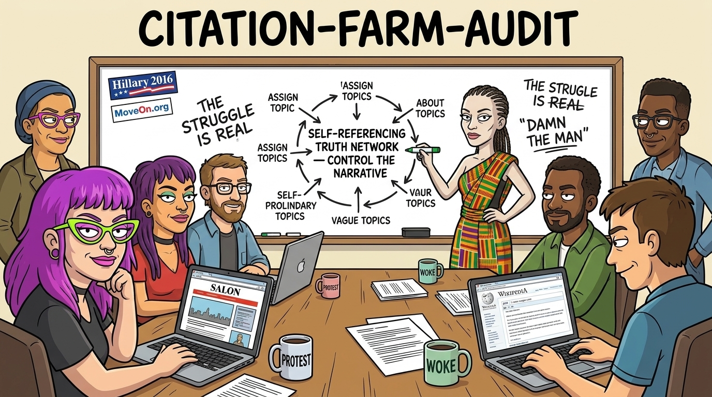
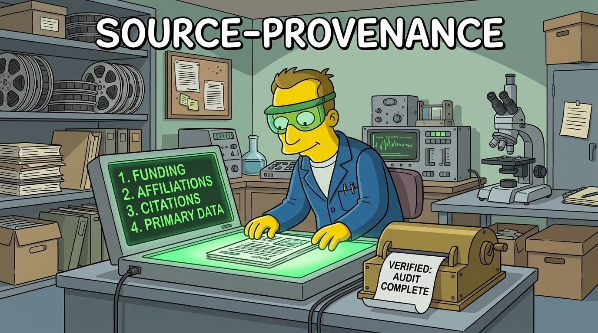

# cui-bono


*Cui bono?* Asks whose voice a text speaks in and who gains if you accept it, then checks the sources under it. `/cui-bono <text|url|file>` names the document's shape (self-certifying opener, two-camp frame, concession-then-pivot, foreclosure line, named-program list with one round figure each, virtue tags, aligning adversary, register markers) and the register it is written in, hands each factual claim to `citation-farm-audit` and each cited source to `source-provenance`, and takes the findings apart with the logic skills, a logic grid and an incompatibility matrix. `/cui-bono` with no argument audits the agent's own previous reply, which is the case that produced the skill. Every side of a debate gets the same checks, and the results are facts you can verify, not labels.

## What you get

- **A cui-bono card per text** (`cui-bono`): the shape score with the triggering quotes, the register and who publishes in it, who gains, every claim with what it cites and what the record shows, the deconstruction (fallacies, stale figures, loaded words), a logic grid of premises against claims, an incompatibility matrix of the held premises, and for the agent's own reply, which voice it reproduced and why.
- **A decomposition per text** (`logic-decomposer`): every sentence numbered and classified, every proposition quoted with its sentence id, conditionals written with their direction and contrapositive, quantifiers with scope, entities and constraints, two grades per proposition (evidence from the record E0–E6, GRADE-adjusted; confidence as stated S1–S7 or S?) with the overclaim/underclaim gap, and a validity report on the decomposition itself.
- **The formal methods, with their working** (`logic-toolbox`): conditional chains, sequencing and grouping setups, the cross-elimination grid, constraint propagation, syllogisms and Venn diagrams, truth tables, indirect proof, the premise logic grid, the incompatibility matrix of held premises with a joint-satisfiability check, assumption and flaw tests, Toulmin maps and Wigmore charts.
- **A network card per claim** (`citation-farm-audit`): the citation graph from the policy document down to its primary data, the people and the money in it (authors, funders, boards, committee seats), the flags raised, where the chain ends (objective data, self-report or opinion), and what was not verified.



- **A person record per recurring name**: degree, thesis and repository link, appointment, funders, organizational roles and network position, each fact with its source. You decide what goes in the flag column.
- **A provenance card per source** (`source-provenance`): funding traced to the funder's own stated mission, author affiliations and career incentives, self-citation counts, the data the claim rests on, whether the method could have come out against its premise, and the declared conflicts set against the record.



## When it runs

- `cui-bono`: on any text that argues for a policy, program, budget or conclusion, and with no argument right after the agent gives a suspicious answer to something scientific or factual the user said.
- `logic-decomposer`: before any formal check of a text, and as step 3 of `cui-bono`.
- `logic-toolbox`: on a decomposition, as step 3 of `cui-bono`, or on any argument or puzzle-shaped problem.
- `citation-farm-audit`: whenever a social-science, psychology, criminology, gender-studies or policy source is used as evidence, and whenever an author's name turns up in three or more sources in your project.
- `source-provenance`: whenever any paper, review, report, white paper or government document is pulled as a source. It hands network-level patterns to `citation-farm-audit`.

## How it checks

- Public scholarly and funding records only: OpenAlex, Crossref, Europe PMC, NIH RePORTER, NSF and USAspending award search, ProPublica Nonprofit Explorer (US 990s) and the CRA charity listings (Canadian T3010s).
- No private correspondence, no contact with anyone's employer, no personal details. Person records hold public, professional facts.
- Funding is recorded as a fact and is never the verdict: the data and the method decide whether the work holds up.

## What's inside

- `skills/cui-bono/SKILL.md`: the eight shape detectors, the register and cui-bono questions, the routing to the two aspect skills, the deconstruction step, the logic grid and incompatibility matrix, the self-audit mode, the card format, and a worked example on an agent's own reply.
- `skills/logic-decomposer/SKILL.md`: segmentation and classification of every sentence, the proposition table, conditionals with direction, quantifiers, entities, relations and constraints, the evidence and stated-confidence grades, and the eight internal validity checks.
- `skills/logic-decomposer/scripts/skeleton.mjs`: numbers a text's sentences and prints the empty P-table, the conditionals table pre-filled with every sentence that carries an indicator word, the empty grades table and the validity checklist: `node skeleton.mjs <textfile>` (or `-` for stdin; `--json`).
- `skills/logic-toolbox/SKILL.md`: fifteen methods, each with the problem it solves, steps, notation, the test it supports, a micro-example and its source.
- `skills/logic-toolbox/references/methods-research-2026-11-08.md`: the research record behind the toolbox and the decomposer, with quotations, and the list of what is still unchecked.
- `skills/logic-toolbox/scripts/grids.mjs`, `truth-table.mjs`, `conditionals.mjs`: print the LOGIC GRID, INCOMPATIBILITY MATRIX and cross-elimination grids (empty or filled), a full truth table with its validity or consistency verdict, and conditional rules with contrapositives, chains and forced values. Node 18+, no dependencies.
- `test/run.js`: runs the four scripts from the command line and compares their output with `test/fixtures/`: `node plugins/cui-bono/test/run.js`.
- `skills/citation-farm-audit/SKILL.md`: the procedure (citation graph, people and money, flags, primary-data reach, fairness, co-authorship network, forward motion), the person-record fields, the network-card format, the API queries, and a worked example.
- `skills/citation-farm-audit/scripts/openalex-profile.mjs`: one author's citation profile from OpenAlex in one run: top works, co-authors, top citers marked as co-authors or not, self-citations, citing fields, funders. Node 18 or later, no dependencies: `node openalex-profile.mjs <OpenAlex author id>`.
- `skills/source-provenance/SKILL.md`: the six checks, the provenance-card format, the fairness rules, the references, and a worked example.

## Requirements

Node 18 or later (built-in `fetch`) for the profile script; curl for the example queries.
Node 18 or later is needed for all the scripts, not only the profile script: `grids.mjs`, `truth-table.mjs`, `conditionals.mjs`, `skeleton.mjs` and `test/run.js` run on plain Node with no dependencies. No API keys. OpenAlex requests without a key share a small daily budget per IP address, so the skill keeps queries narrow and caches results under `~/.local/share/claude/`.

## Install

```sh
/plugin marketplace add github:gnomatix/gnomatix-oss-skills
/plugin install cui-bono@gnomatix-oss-skills
```

For other agents, the skills are linked from `.agents/skills/`, `.github/skills/` and `.kiro/skills/` at the repo root; see the main README.

<!-- BEGIN: gnomatix-license-include -->
## License

**[Business Source License 1.1](https://github.com/gnomatix/gnomatix-oss-skills/blob/main/LICENSE)** (`BUSL-1.1`). The source is available, but this is not OSI open source.

**Commercial use is strictly prohibited without a paid commercial licensing / usage agreement with GNOMATIX.** Use by or for any government, government agency or charity is commercial use. Contact GNOMATIX first to arrange either of these:
- an ongoing support & development agreement
- a reasonable one-time usage fee, paid via [Buy Me a Coffee](https://www.buymeacoffee.com/gnomatix)

Both support continued development work on GNOMATIX projects. Contact: [`sales@gnomatix.com`](mailto:sales@gnomatix.com) or [LinkedIn](https://www.linkedin.com/company/gnomatix). General product support: [`support@gnomatix.com`](mailto:support@gnomatix.com).

The full terms, including the Additional Use Grant, the Change Date and the Change License, are in [`LICENSE`](https://github.com/gnomatix/gnomatix-oss-skills/blob/main/LICENSE).
<!-- END: gnomatix-license-include -->
