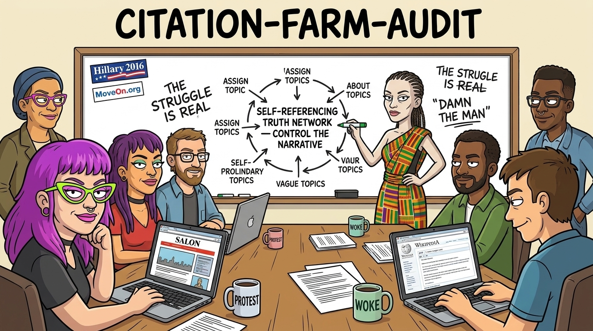

# citation-farm-audit



## Purpose

Flags bias networks and citation farms: citation farming in the social sciences, used to give claims legitimacy in government and policy. A committee or agency has to cite publications; people on it with friends at institutions can fund work that supports their case, cite it, be cited back, and all become the experts. Following the money and the citations shows the network.

Openly partisan think tanks are known quantities: their leanings are in the open. The harder case is people embedded at public universities, in social-science and psychology departments, who are not reliable sources: dig into their degrees and the theses do not hold up. Their names come up a lot and get cited, so each recurring name gets a person record, thesis included, and a flag where the record warrants one.

This is a reliability database, not a campaign against individuals. It records verifiable facts about published work, funding and network position, and puts a flag on sources and networks whose work is not of top quality. It judges authors and teams by their record, not by their institution.

## Background

- **Citation cartels.** Fister Jr., Fister & Perc, "Toward the discovery of citation cartels in citation networks", *Frontiers in Physics* 4:49 (2016), doi:[10.3389/fphy.2016.00049](https://doi.org/10.3389/fphy.2016.00049). They define a cartel as a group of authors who cite each other disproportionately more than they cite other groups working on the same subject, and treat it as a community-detection problem on the author citation graph. That is the test in step 3.
- **Journal-level enforcement.** Clarivate suppresses Journal Impact Factors "in cases where the metric is distorted by excessive self-citation or citation stacking"; the decision "is a point-in-time analysis based on objectively applied criteria" ([Clarivate, "A Refresher Course on JCR Journal Suppression Policies", 2017-06-23](https://clarivate.com/academia-government/blog/refresher-course-jcr-journal-suppression-policies/)). Retraction Watch reported the 2023 suppressions for citation stacking, "sometimes referred to as 'citation cartels'" ([Retraction Watch, 2023-06-28](https://retractionwatch.com/2023/06/28/truly-devastating-four-journals-wont-get-new-impact-factors-this-year-because-of-citation-shenanigans)). This skill holds itself to the same standard: the pattern is reported on objective criteria, without presuming wrongdoing.
- **Author self-citation metrics.** Ioannidis, Baas, Klavans & Boyack, "A standardized citation metrics author database annotated for scientific field", *PLoS Biology* 17(8):e3000384 (2019), doi:[10.1371/journal.pbio.3000384](https://doi.org/10.1371/journal.pbio.3000384). It reports every metric with and without self-citations, plus the ratio of citations to citing papers. A high citations-per-citing-paper ratio means the same few papers cite an author many times each.
- **Woozle chain** (the term this skill uses): a claim that becomes "established" because it is cited repeatedly, not because the cited source supports it.
- **Policy citation of grey literature.** In Overton-indexed policy documents, 4.7% of government documents cite scholarly work, against 20.9% of intergovernmental, 31.0% of think-tank and 68.3% of NGO and other-repository documents; 7.4% of government documents cite another policy document (Murat, Fang, Noyons & Costas, "Evidence for studying interactions between science and policy: An exploration of scholarly and policy references in Overton-indexed policy documents", *Journal of Data and Information Science* 11(1):63–87 (2026), doi:[10.2478/jdis-2025-0054](https://doi.org/10.2478/jdis-2025-0054); author-accepted manuscript [arXiv:2601.01764](https://arxiv.org/pdf/2601.01764), p. 13). Among 438 think tanks, policy citations are highly concentrated: five receive almost 29% of them ([On Think Tanks](https://onthinktanks.org/articles/beyond-the-survey-what-policy-citations-can-tell-us-about-think-tanks/)).
- **The Folta precedent.** In 2015 US Right to Know (USRTK) sent public-records requests for the emails of US public-university scientists who had contributed to the industry-backed website GMOanswers.com or spoken out against California's GM-food labelling proposition; Nature Biotechnology put the number at forty ("Standing up for science", *Nature Biotechnology* 33:1009, 2015-10-08, doi:[10.1038/nbt.3384](https://doi.org/10.1038/nbt.3384)). The coverage centred on Kevin Folta, University of Florida horticultural sciences: Eric Lipton, "Food Industry Enlisted Academics in G.M.O. Lobbying War, Emails Show", *New York Times*, 2015-09-05; and a PLOS blog post that PLOS removed after criticism ([Retraction Watch, 2015-08-24](https://retractionwatch.com/2015/08/24/following-criticism-plos-removes-blog-defending-scrutiny-of-science/)). The editorial states that the $25,000 from Monsanto was a donation to his university's Foundation outreach program, tied neither to him nor to his research; that his conflict-of-interest disclosures complied with his university's rules; that he broke no laws and never used industry funds for personal gain; and that he and his family were harassed. It also states that USRTK was "bankrolled largely by a $47,500 donation from the Organic Consumers Association". For the method: the funding was a verifiable fact and no misconduct was found. Step 5 takes the lesson: a funder is a reason to look at the method, never the verdict, and whoever runs the audit gets the same card as the people audited.

## Procedure

Run it on any policy-relevant source before it is cited as evidence, and on any author whose name has turned up in three or more sources in the project.

### 1. Build the citation graph, top to bottom

Start at the policy document (statute, UN or WHO report, government page, court ruling, NGO fact sheet). For each factual claim it makes:

1. Record what it cites (or that it cites nothing).
2. Follow each citation to its source and record what *that* cites for the same claim.
3. Keep going until the chain ends in one of: primary data (a dataset, a registry, a measured outcome), a primary study (original collection), or a dead end (an uncited assertion, an opinion, a press release, a broken link).
4. At each node record: type (statute / agency report / UN or IGO report / think-tank or NGO report / peer-reviewed primary / peer-reviewed review / book / press), year, authors, publisher, funder as declared, and whether the claim at this node matches the claim at the node below it (quote both).

Draw it (mermaid or ASCII, see Output). A claim whose figure changes, rounds up or loses its qualifier between nodes is marked at the edge where it changed.

### 2. Map the people and the money

For every author and organization in the graph:

- **Authors**: current and past affiliations, co-authors (step 6), roles on the boards, advisory panels, committees or commissions that produced or used the policy document.
- **Funders**: declared funding in each paper (acknowledgements, Crossref `funder` field, OpenAlex `funders`/`awards`), grants (NIH RePORTER, NSF, SSHRC/CIHR, ESRC/UKRI, NIJ/OVW/DOJ), foundation grants (US 990 Schedule I, Canadian T3010), and the funder's stated mission.
- **Organizations**: think tanks, NGOs, advocacy groups and professional bodies in the graph: board and staff lists, revenue sources (990 / T3010), and whether they lobby for the policy the document supports.
- **Overlaps**: the same person in two roles in one chain (author of the evidence and member of the committee citing it; reviewer or editor of the journal that published it; funder's board and the grantee's paper).

### 3. Flag patterns (each flag needs a link to the evidence)

A flag line is `[FLAG] <type>: <one-line fact>  <evidence url>`, the URL on the same line. A line without its URL is not a flag and is not written; where the evidence was not retrieved, the line reads `[FLAG candidate] <type>: <fact>  evidence not retrieved: <what was tried>`. The URLs under Graph or People do not stand in for the flag's own. The primary-data reach line carries the end node's URL the same way.

| Flag | What counts | How to check |
|---|---|---|
| Closed citation loop | A cites B cites C cites A for the same claim, with no node reaching primary data | Step 1 graph |
| Mutual-citation cluster | A small group whose top citers are mostly each other or their co-authors (the Fister community test) | OpenAlex: top citing authors of the person's most-cited works, marked against their co-author list |
| High self-citation | Self-citations a large share of citing works, or citations-per-citing-paper well above field peers | OpenAlex self-citing count; Ioannidis database (with/without self-cites) |
| Woozle chain | The claim gets stronger, larger, or more general at each citation step, or the chain never reaches the data it implies | Step 1, quote both ends |
| Shared funder | The same funder pays for the research, the report that cites it, and the advocacy that uses it | Step 2 |
| Author-reviewer-citer overlap | One person authors the evidence, reviews or edits it, sits on the body citing it, or cites it in a commissioned report | Step 2; journal editorial boards; committee member lists |
| Grey literature promoted to evidence | A report with no peer review or data release becomes the cited source in a government or UN document | Step 1 node types |
| Advocacy-funded justification | An advocacy group funds the research that is then cited to justify the advocacy group's program or funding | Steps 1 and 2 |

### 4. Primary-data reach

For each claim, say where the chain ends, with the link:

- **Objective or official data**: .gov or agency statistics, registries, court or police records, measured outcomes (biomarker, device, administrative record).
- **Self-report only**: surveys, questionnaires, interviews. Record which instrument (for IPV: CTS, CTS2, NVAWS, NISVS, GSS). If an objective comparison exists, link it.
- **Opinion only**: the chain ends in an argument, a review that cites no data for this claim, or an uncited figure.

### 5. Fairness

- Report verifiable facts: who wrote it, who paid, who sat where, who cites whom, where the chain ends. Do not write motives.
- Funding alone is not proof of a bought result (the Folta precedent). A shared funder is a flag to look at the method; the verdict comes from whether the method and the data hold up.
- Apply every check to every side of a debate: the same queries on the researchers of each camp, and on the government bodies that fund each.
- A cluster can be a real subfield. Ten people working on one narrow question will cite each other. The flag records the fact; it is not the verdict.

### 6. Co-authorship network over time (the "A-team" test)

For each recurring author:

1. List co-authors by decade (OpenAlex `group_by=authorships.author.id` on their works, filtered by `publication_year`).
2. Do they co-author with established researchers in the field: people whose findings have been replicated by independent groups, and who are cited across the field, not only inside their own group?
3. Is their work cited outside their own cluster, and does it keep being cited over the years? Measure: share of the top citing authors who are not their co-authors; citing works in the last five years; citing works by field.
4. Are they unknown to the field's established network (no co-authorship or citation links to its central people)?

Record the result in the person record as **"inside established network"** with the links that show it, or **"outside network: new subfield or unverified"**. The second label is a fact about network position, not a judgment; the author of the project decides what it means.

### 7. Forward motion

Does the person's work feed finished, delivered things that other people build on: an instrument others use (a scale, a dataset, a risk tool), a meta-analysis others cite as the reference, a program evaluated in practice, a dataset in a public archive? Or does it circle inside a small niche: new instruments that nobody else adopts, re-running the same debate in reply papers, citations mostly from the same few people?

Record facts only: which works are used by others (with citation counts and fields of the citing works), what was delivered (instrument, dataset, program, statute), and how much of the citation traffic is reply-and-rebuttal between the same names. No verdict.

## Person records (for recurring names)

All facts are public and professional, each with a source URL. No private information (no home address, family, health, personal life, or allegations about conduct outside their published work). A fact not found at a primary record is written "not found". Secondary sources (encyclopedias, obituaries, booksellers, blogs) are leads to a primary record, never the record.

| Field | Where to look |
|---|---|
| Name, OpenAlex ID, ORCID | OpenAlex `/authors?search=`; check the profile is not merged with another person of the same name (look at the top works) |
| Highest degree, year, institution, field | Faculty page, CV, university news, ORCID |
| Thesis title and repository link | University repository (e.g. scholars.unh.edu/dissertation), ProQuest Dissertations record page, Library and Archives Canada (Theses Canada), WorldCat |
| Current or last appointment | Faculty page, university directory |
| Funders | OpenAlex `group_by=funders.id` on their works; NIH RePORTER; NSF award search; Canadian tri-agency award databases; acknowledgements |
| Advocacy or organizational roles | Organization websites (board and staff lists), 990s / T3010s, government committee rosters, publicly documented expert-witness work, journal editorships |
| Citation-network facts | Steps 3, 6 and 7 above |
| Network position | "inside established network" or "outside network: new subfield or unverified", with the links |
| Flag | Left blank for the author of the project |

## Output

### Network card

```
NETWORK CARD: <policy document or claim>
Date: <YYYY-MM-DD>   Auditor: <agent/session>

Claim: "<exact text from the policy document>"  <url>

Graph:
  <policy doc> --cites--> <report> --cites--> <paper> --data--> <dataset|NONE>
  (mermaid block if more than ~6 nodes)

People and money:
  <name> | <role in chain> | <affiliation> | <funder(s)> | <other seats>  <urls>

Flags:
  [FLAG] <type>: <one-line fact>  <evidence url>
  ...
Primary-data reach: objective | self-report only | opinion only  <url of the end node>
Fairness check: same queries run on <opposing camp>: <result>
Verdict: <one or two sentences: what the chain supports and where it stops>
Unverified: <every item not checked against a primary record>
```

### Person record

One table row per person in the project's source-reliability file, with the fields above and a source URL per fact.

## Tools

No Python. curl or Node (built-in `fetch`, Node 18+). OpenAlex is free with no key; requests without a key share a small daily budget per IP, so cache results under `~/.local/share/claude/` and keep each query narrow with `select=` and `group_by=`. Do not send the user's email to OpenAlex or any other service to get a key unless the user asks.

### OpenAlex (every query below run 2026-11-04)

```bash
# Find an author; check the top works to make sure the profile is the right person
curl -s "https://api.openalex.org/authors?search=John%20Archer&select=id,display_name,orcid,works_count,cited_by_count,last_known_institutions&per_page=3"

# One work: references, citations, funders
curl -s "https://api.openalex.org/works/doi:10.1037/0033-2909.126.5.651?select=id,title,referenced_works_count,cited_by_count,funders,awards"

# Who cites a work, grouped by citing author (mutual-citation test)
curl -s "https://api.openalex.org/works?filter=cites:W2075254395&group_by=authorships.author.id"

# Does author X cite work W? (pairwise edge)
curl -s "https://api.openalex.org/works?filter=authorships.author.id:A5042046671,cites:W2075254395&select=id,title,publication_year"

# Co-authors of an author (A-team test); the decade filter is optional
curl -s "https://api.openalex.org/works?filter=author.id:A5042046671,publication_year:1990-1999&group_by=authorships.author.id"

# Fields of the works citing a work (forward-motion test; OR up to 100 work IDs with |)
curl -s "https://api.openalex.org/works?filter=cites:W2075254395&group_by=primary_topic.field.id"

# Funders across an author's works
curl -s "https://api.openalex.org/works?filter=author.id:A5042046671&group_by=funders.id"
```

One author's profile in one run (top works, co-authors, citers marked co-author or not, self-citations, citing fields, funders):

```bash
node "${CLAUDE_PLUGIN_ROOT}/skills/citation-farm-audit/scripts/openalex-profile.mjs" A5042046671
```

Check by hand for OpenAlex artifacts: profiles merged across people with the same name (do the top works fit the person's field?); funders attached by name-matching (a funder whose name matches an author's surname); a book by other authors attached to a profile through a reviewer's or editor's name.

### Funding and organization records (every query below run 2026-11-04)

```bash
# Crossref funder registry: funder DOI for a name, then the works it funded
curl -s "https://api.crossref.org/funders?query=national+institute+of+justice&rows=3"
curl -s "https://api.crossref.org/funders/100005289/works?rows=5&select=DOI,title,author"

# NIH RePORTER: projects by PI (POST, JSON); or by "project_nums" for grant numbers from a paper
curl -s -X POST "https://api.reporter.nih.gov/v2/projects/search" -H "Content-Type: application/json" \
  -d '{"criteria":{"pi_names":[{"last_name":"<last>","first_name":"<first>"}]},"include_fields":["ProjectNum","ProjectTitle","FiscalYear","Organization","AwardAmount"],"limit":25}'

# US nonprofits (990s): ProPublica Nonprofit Explorer; the EIN comes from the search result
curl -s "https://projects.propublica.org/nonprofits/api/v2/search.json?q=<organization+name>"
curl -s "https://projects.propublica.org/nonprofits/api/v2/organizations/<EIN>.json"   # filings, revenue, officers
```

- Canadian charities (T3010): CRA charity listings, https://apps.cra-arc.gc.ca/ebci/hacc/srch/pub/dsplyBscSrch (directors, revenue, gifts to qualified donees).
- US federal grants: NSF award search (https://www.nsf.gov/awardsearch/), USAspending (https://www.usaspending.gov/).
- Theses: the university's own repository, ProQuest Dissertations record pages, Theses Canada (Library and Archives Canada), WorldCat.

## Worked example: Archer 2000, who cites it

The run came back without a cartel flag. That outcome is part of the example: the method has to be able to return "no".

```
NETWORK CARD: Archer (2000), Sex differences in aggression between heterosexual partners:
  a meta-analytic review, Psychological Bulletin 126(5):651-680,
  doi:10.1037/0033-2909.126.5.651, OpenAlex W2075254395
Date: 2026-11-04   Source: OpenAlex API, retrieved 2026-11-04

Facts:
  cited_by_count 2,508; referenced_works 247; funders: none declared; awards: none
  Top citing authors (works citing it): Gregory L. Stuart 44, Ryan C. Shorey 40,
    Elizabeth A. Bates [co-author] 35, Nicola Graham-Kevan [co-author] 33,
    John E. Archer [self] 32, Murray A. Straus 31, Denise A. Hines 27,
    Donald G. Dutton 22, Cory A. Crane 21, Suzanne Catherine Swan 20
  Citing works 2021-2026: 401
  Citing works by field: Social Sciences 2,070; Psychology 305; Medicine 47
  Archer's self-citations of his five most-cited works: 60 of 7,835 citing works (0.8%)

Flags: none raised.
  Mutual-citation cluster: 2 of the 9 top non-self citers are co-authors; the largest
    single citer accounts for 44 of 2,508 citing works (1.8%).
  Shared funder: no funder declared.
Primary-data reach: a meta-analysis of published studies. The abstract reports that
  measurement method and sample were moderators, and that the database "is biased toward
  young dating samples in the United States".
Network position: inside established network; cited across the social sciences,
  psychology and medicine since 2000, 401 times in 2021-2026.
Verdict: no cartel signal in the citation network. The limits the abstract names are
  the measures and the samples, not the network.
Unverified: none.
```

## Hand-offs

- One paper's provenance (funding to mission, a method that could return a result against its premise, declared vs actual conflicts): `source-provenance`.
