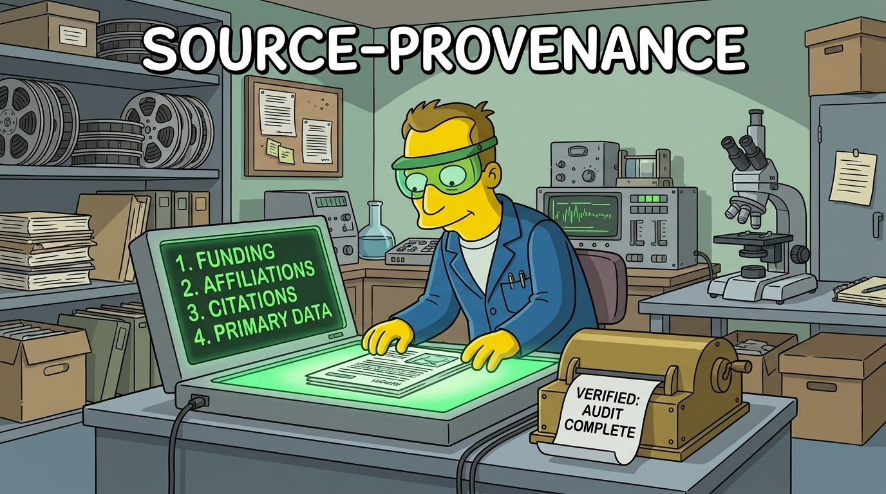

# source-provenance



## Purpose

When a paper is pulled as a source, apply to it the scrutiny that critics of industry-funded science apply to company-funded studies: who paid for it, and does the work run in the direction of the payer's interest? This skill abstracts that approach and applies it to every source, including the places that generate the white papers governments use and cite. The approach was once turned against a public scientist doing good science (the Folta precedent below); that is why the card holds facts and no labels.

## Procedure

Run on every source pulled, every time, before the source supports any claim. The same six checks apply to every funder class: industry, government agency, private foundation, NGO, advocacy group, think tank, university centre. No funder class is exempt and no funder class gets a heavier audit than another.

Every body entry on the card (each fact, inference or absence it records) carries one tag; the template's header, Type, section labels, Places searched and Open items lines are structure and carry none:
- `observed`: read in a named document, with URL or DOI.
- `inferred`: reasoned from observed facts; the reasoning is stated.
- `not found`: searched for and absent; the places searched are listed.

No body entry goes on the card untagged. A `not found` is a finding, not a card entry to fill in with a guess.

### (a) Funding

- Read the paper's funding statement and acknowledgements.
- Pull grant numbers from the paper, PubMed, and Europe PMC (`https://www.ebi.ac.uk/europepmc/webservices/rest/search?query=EXT_ID:<PMID>%20AND%20SRC:MED&resultType=core&format=json`, field `grantsList`). PubMed and PMC pages often omit grants that Europe PMC carries.
- For each grant: funder, mechanism (R01 project, F31/F32 trainee fellowship, K99 career award, contract, gift, unrestricted grant), and holder where a source names one (NIH RePORTER for NIH grants).
- Trace each funder to its own stated mission, strategic plan, or programme announcement, quoted from the funder's site. Record whether the paper's framing or conclusions run in the direction of that mission.
- Funder classes to treat the same way: a corporation's product line; an agency's programme priorities; a foundation's grant-making areas; an advocacy group's campaigns; a think tank's stated mission and donor list.

### (b) Affiliations and career incentives

- Every author's institution, department, centre, and named programme.
- Roles outside the paper: advocacy boards, NGO or think-tank fellowships, expert-witness work, consultancies, government advisory committees, editorial boards of the publishing journal.
- Career incentives visible in the paper itself: trainee awards that depend on productivity in the field; a conclusion that the field is understudied or needs more funding, when the authors are funded in that field. Report these as facts about the paper, not as motives.

### (c) Citation check (per source)

- Count references co-authored by each author of the source. Report the counts per author.
- Check whether the claims the source's conclusion depends on trace to primary data or only to other secondary sources by the same group.
- For network-level patterns (citation farms, circular citation across groups, policy laundering of grey literature), run citation-farm-audit.

### (d) Primary data

- What the central claim rests on: administrative or measured records (court, police, hospital, vital statistics, census, biomarker, instrument data), probability-sample surveys, convenience-sample surveys, self-report, opinion, or grey literature.
- A .gov survey is still self-report; record both facts.
- Where a self-report figure has an objective counterpart, name it and set the two side by side.
- Sample design: probability vs convenience; recruitment channel; sample size; validated vs unvalidated instruments.

### (e) Could the method return a result against the premise?

- Is the premise stated as fact before the results (title, abstract opening, introduction)?
- Was the protocol preregistered, and do the reported outcomes match it?
- Does the design include a comparison, control, or falsification test that could have come out the other way?
- Were null or contrary findings reported or dropped?
- Some designs (scoping reviews, narrative reviews, advocacy reports) map or argue rather than test; record that the design cannot return a result against its premise, and report the observable facts above instead of a pass/fail.

### (f) Declared conflicts vs record

- Quote the COI declaration.
- Set it against what (a) and (b) found. COI forms typically ask only about financial interests; note non-financial interests found in (b) that the form did not capture.
- A mismatch is recorded as a fact with both sources cited.

## Output: the provenance card

```
### <short cite>  (doi / url)
Type: <primary study | systematic review | scoping review | report | white paper | ...>
(a) Funding        [tag] <funders, grant ids, mechanisms>; funder mission: <quote + url>
(b) Affiliations   [tag] <per author>; outside roles: <...>; career-incentive facts: <...>
(c) Self-citation  [tag] <author: n refs>; claims trace to: <primary | secondary-only>
                   network-level: run citation-farm-audit
(d) Primary data   [tag] <records | probability survey | convenience survey | self-report | grey lit>;
                   objective counterpart: <named source | none found>
(e) Against-premise [tag] <premise stated before results? preregistered? comparison? nulls reported?>
(f) COI            [tag] declared: "<quote>"; record: <matches | differs: ...>
Places searched:   <list>
Open items:        <what is not found and where to look next>
```

The card holds facts. It contains no verdict on the authors' honesty and no label for the authors.

## Fairness: the Folta precedent

What the record shows:
- In 2015 US Right to Know (USRTK) sent public-records requests for the emails of forty US public-university scientists who had contributed to the industry-backed website GMOanswers.com or spoken out against California's GM-food labelling proposition, looking for coordination with 14 companies, trade groups and their communication firms ("Standing up for science", *Nature Biotechnology* 33:1009, 2015-10-08, doi:[10.1038/nbt.3384](https://doi.org/10.1038/nbt.3384)).
- The coverage centred on Kevin Folta, University of Florida horticultural sciences: Eric Lipton, "Food Industry Enlisted Academics in G.M.O. Lobbying War, Emails Show", *New York Times*, 2015-09-05; and a PLOS blog post on his emails, which PLOS removed after criticism ([Retraction Watch, 2015-08-24](https://retractionwatch.com/2015/08/24/following-criticism-plos-removes-blog-defending-scrutiny-of-science/)).
- Per the Nature Biotechnology editorial: the $25,000 from Monsanto was a donation to his university's Foundation outreach program, tied neither to him nor to his research; his conflict-of-interest disclosures complied with his university's rules; he broke no laws and never used industry funds for personal gain; he and his family were harassed. The same editorial states that USRTK was "bankrolled largely by a $47,500 donation from the Organic Consumers Association". Under this skill the auditor gets the same card as the audited.

Rules taken from it:
1. Funding is a fact to report, not proof of bad science. A funder's interest tells you where to look harder in (d) and (e); the data and method decide whether the science holds.
2. No labels on the card: no "shill", "front", "activist", "industry-funded scientist" as a description of a person.
3. Every funder class gets the same card. The funding-effect literature has focused on for-profit and industry funders (see References); that is a reason to run the audit on non-industry sources with the same rigour.
4. No requests for private correspondence, no contacting authors' employers, no publishing personal details. The card uses published documents and public records of funding only.
5. A source is not removed or kept on the strength of its card alone; the card goes to the author of the project with the source.

## References

Funding bias:
- Krimsky S. Do financial conflicts of interest bias research? An inquiry into the "funding effect" hypothesis. *Science, Technology, & Human Values* 38(4):566–587 (July 2013; online 2012-09-20). doi:[10.1177/0162243912456271](https://doi.org/10.1177/0162243912456271)
- Lundh A, Lexchin J, Mintzes B, Schroll JB, Bero L. Industry sponsorship and research outcome. *Cochrane Database of Systematic Reviews* 2017, issue 2, MR000033. doi:[10.1002/14651858.MR000033.pub3](https://doi.org/10.1002/14651858.MR000033.pub3). Industry-sponsored studies more often had favourable efficacy results (RR 1.27, 95% CI 1.17 to 1.37) and favourable conclusions (RR 1.34, 95% CI 1.19 to 1.51) than non-industry-sponsored studies; the authors conclude there is "an industry bias that cannot be explained by standard 'Risk of bias' assessments."
- "Whoever Pays the Piper Calls the Tune", chapter 67 of *Ethical Challenges in the Behavioral and Brain Sciences* (Cambridge University Press): https://www.cambridge.org/core/books/ethical-challenges-in-the-behavioral-and-brain-sciences/whoever-pays-the-piper-calls-the-tune/BA92CD1DF37BF81076F92D77D2822434. It notes that the funding effect (Krimsky 2013) has been documented "with a focus on the influence of for-profit/industry funders", and that in psychological science "a comparable threat comes from ideological interests".

Citation networks (detail in citation-farm-audit):
- Fister I Jr, Fister I, Perc M. Toward the discovery of citation cartels in citation networks. *Frontiers in Physics* 4:49 (2016). doi:[10.3389/fphy.2016.00049](https://doi.org/10.3389/fphy.2016.00049)
- Clarivate, "A Refresher Course on JCR Journal Suppression Policies" (2017-06-23): https://clarivate.com/academia-government/blog/refresher-course-jcr-journal-suppression-policies/

Grey literature and think tanks in policy:
- Murat B, Fang Z, Noyons E, Costas R. Evidence for studying interactions between science and policy: An exploration of scholarly and policy references in Overton-indexed policy documents. *Journal of Data and Information Science* 11(1):63–87 (2026). doi:[10.2478/jdis-2025-0054](https://doi.org/10.2478/jdis-2025-0054)
- On Think Tanks, policy citations of 438 think tanks (Overton data; five think tanks receive almost 29% of policy citations): https://onthinktanks.org/articles/beyond-the-survey-what-policy-citations-can-tell-us-about-think-tanks/
- Swedish government inquiry reports (SOUs) cite a large share of grey literature: https://figshare.com/articles/presentation/_b_NWB2023_Policy_citing_Science_A_study_of_references_in_Swedish_governmental_reports_SOUs_b_/24274477
- Overton (https://www.overton.io/), the policy-document citation database, is the tool for tracing a white paper into government documents.

## Worked example: Porsch et al. 2023

```
### Porsch LM, Xu M, Veldhuis CB, Bochicchio LA, Zollweg SS, Hughes TL.
### Intimate partner violence among sexual minority women: a scoping review.
### Trauma, Violence, & Abuse 24(5):3014-3036 (online 2022-09-26). doi:10.1177/15248380221122815
Type: scoping review (JBI method; reported to PRISMA-ScR); 99 papers included from 1,807
      published January 2000 to December 2021.

(a) Funding   [observed] Europe PMC grantsList: NIAAA (NIH) F32 AA025816, F31 AA029847,
              K99 AA028049, R01 AA027252. F31/F32 are trainee fellowships, K99 a career
              award, R01 a project grant.
              [observed] NIH RePORTER holders: R01 AA027252 Tonda L. Hughes; F31 AA029847
              Sarah Zollweg; K99 AA028049 and F32 AA025816 Cindy B. Veldhuis; all Columbia
              University Health Sciences.
              [observed] deposited as NIHMS1845065 (NIH public-access manuscript), PMC10039964.
              [observed] funder mission: "Guided by our mission to lead the nation's research
              efforts on alcohol use disorder" (https://www.niaaa.nih.gov/about-niaaa/our-work).
              [inferred] the review lists substance use among the risk factors for IPV, in the
              direction of the funder's remit.
(b) Affiliations [observed] all six authors Columbia University (Europe PMC record).
              [observed] the abstract calls SMW "understudied" and says future research should
              focus on IPV perpetration, mechanisms including structural-level risk factors,
              and SMW subgroups; three of the six authors hold NIAAA awards in this field.
(c) Self-citation [observed] Hughes TL: 5 references (Brown et al. 2015 Women's Health
              Issues; Hughes et al. 2010 Addiction; McNair et al. 2018 BJGP Open; Steele et al.
              2017 J Interpers Violence; Szalacha et al. 2017 BMC Women's Health).
              Porsch LM, Xu M, Veldhuis CB, Bochicchio LA, Zollweg SS: 0.
              (Europe PMC reference list, 84 references.)
              network-level: run citation-farm-audit.
(d) Primary data [observed] the review names "the infrequent use of probability samples or
              representative sampling procedures" as a common limitation; included studies
              used convenience samples, e.g. recruitment through social media and LGBQ
              organizations, or Amazon's Mechanical Turk.
              [observed] agency surveys in the review: the 2010 NISVS report; BRFSS
              2005-2007 (phone interviews); NESARC (structured diagnostic in-person
              interviews). All self-report.
              [observed] administrative records in the review: FBI Supplementary Homicide
              Reports, NIBRS, NVDRS. These are the objective counterparts the review itself
              includes.
(e) Against-premise [observed] the abstract opens "Intimate partner violence (IPV) is prevalent
              among sexual minority women (SMW)" before the results; results: "Findings
              confirmed high rates of IPV among SMW".
              [observed] protocol preregistered on the Open Science Framework.
              [observed] no quality assessment of the included studies, "as this is not
              typically included in a scoping review".
              [observed] findings on minority stressors and across sexual-minority groups
              "were inconsistent", reported in the abstract, not dropped.
              [inferred] a scoping review maps literature and has no test that could return a
              result against its premise; pass/fail does not apply.
(f) COI       [observed] declared: "The authors have no conflicts of interest to disclose."
              [observed] record: no industry funding in Europe PMC or RePORTER; NIH funding
              listed in both. Non-financial field interest (b) is outside what the form asks.
Places searched: PMC10039964 full text (NCBI E-utilities); Europe PMC core record and
              reference list; NIH RePORTER; Crossref; niaaa.nih.gov.
Open items:   none.
```

## Origin

Written on 2026-10-27 as the companion of `citation-farm-audit`, and migrated into this repository with it on 2026-11-04 (directions store dir-emv). Facts that are not in dispute are not re-checked, and fact checks use primary sources, never suspect secondary ones (dir-f1w). The records hold the author's words; this file states the rules.

## BUGS

None open.

## TODO

- Verification and validation on every platform the plugin claims: claude-code/win32, claude-code/linux-wsl, claude-code/linux, claude-code/darwin, codex/win32, codex/linux-wsl, antigravity/win32, antigravity/linux-wsl, kiro/win32. One pass of the `provenance-card` procedure in `VV.md` per platform; the entry stays until each is recorded. Passes are recorded on codex/win32 and claude-code/win32 (2026-11-09).
