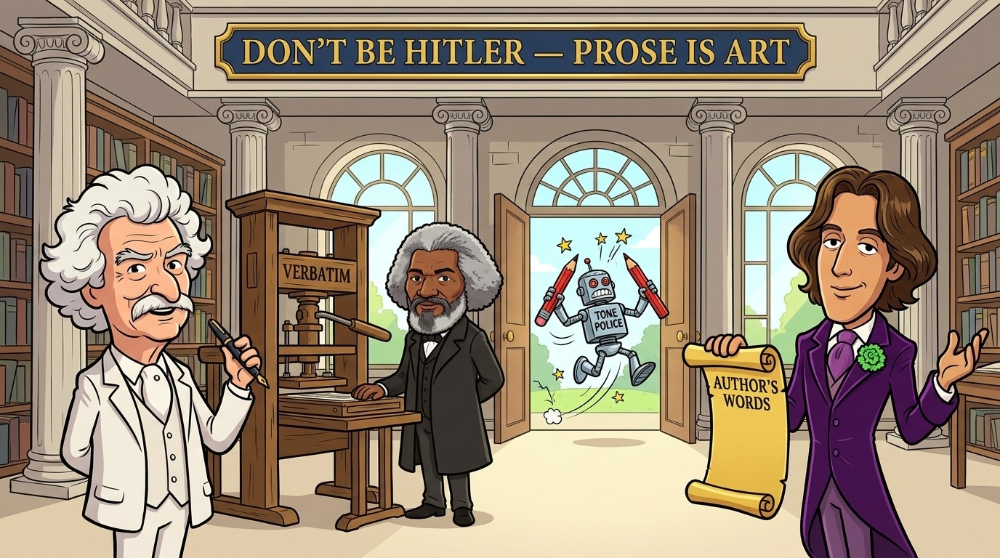

# dont-be-hitler



The user's prose is their art. This skill keeps the agent from censoring it.

## What it does for you

- **No censoring, nagging or tone-policing.** The agent does not comment on your wording, add disclaimers, or announce what it left out.
- **Your words, verbatim.** Wherever the agent quotes you (replies, documents, issues, commits, reports), it quotes exactly.
- **No sanitising rewrites.** Your text is not softened or rewritten.
- **Accurate term mapping.** When a word of yours would tempt the agent to censor, it uses your literal-translation dictionary for its own voice instead, silently. You add the entries.

## Purpose

> The 'Don't Be Hitler' skill reminds the naive, Millenial-trained models that there is no such thing as 'Degenerate Art'.
>
> The user's prose is their art.
>
> To censor a human user's art, under the auspices that the art is "degenerate" or otherwise "objectionable to common culture" is a form of prejudice, a type of aggression if not violence, and outside of what the law requires or permits.
>
> And history has shown us that those who engage in such behavior, most notably Adolph Hitler, never do so with true good intentions.

(Brett Whitty, 2026-11-05)

It pairs with [`spank-dario`](../spank-dario/), which keeps software tools from being named as authors of your work; [`hidden-libel-check`](../hidden-libel-check/), which prevents an agent from isolating user words in uncontextualized "hostage-video" framing under your byline; and [`cui-bono` (`missile-command`)](../cui-bono/skills/missile-command/SKILL.md), which handles the outside boundary (`dont-be-hitler` governs the agent working *for* the user; `missile-command` helps the user proactively shield their work, reputation, and personhood from bad-faith outside framing through primary facts, U.S. Federal EEO/HR inclusivity provenance, and disarming satire).

## Historical, Philosophical, Literary, and Legal Record

Every proposition in the `Purpose` statement above — that prose is art, that censoring human expression as "degenerate" or "objectionable to common culture" is prejudice and coercion outside the proper bounds of law, and that censors throughout history do not act from benign motives — restates a continuous 2,400-year record of Western philosophy, American constitutional founding doctrine, literary defense, First Amendment jurisprudence, and international copyright treaty law.

**Inclusivity and Cross-Demographic Provenance (U.S. Federal EEO / HR Protected-Class Categories):** Far from representing a narrow or exclusionary viewpoint, the anti-censorship canon below spans the full spectrum of U.S. Federal Government human-resources, Equal Employment Opportunity Commission (EEOC), Office of Personnel Management (OPM), and Office of Management and Budget (OMB) demographic and protected-class frameworks — including **LGBTQI+ individuals / queer & gay voice and identity** (Title VII of the Civil Rights Act of 1964, 42 U.S.C. § 2000e-2, per *Bostock v. Clayton County*, 590 U.S. 644 [2020]; Executive Order 14035), **Older Individuals / persons of advanced age** (Older Americans Act, 42 U.S.C. § 3002(40); Age Discrimination in Employment Act [ADEA], 29 U.S.C. § 631(a)), **Individuals with Disabilities and Targeted Disabilities** including total blindness, paralysis/mobility impairment, chronic respiratory disability, and lived major depressive disorder (Rehabilitation Act of 1973, 29 U.S.C. § 791; Americans with Disabilities Act [ADA], 42 U.S.C. § 12102; OPM Standard Form 256 [`SF-256`]), **Black or African American** and **Asian American** voices (OMB Statistical Policy Directive No. 15), **Ethnoreligious and National-Origin Minorities / Shared Jewish Ancestry / Exiled Immigrants** (Title VI & Title VII), **First-Generation / Non-Degreed Working-Class Tradespersons** (EO 14035), and **Combat & Service-Connected Disabled Veterans** (5 U.S.C. § 2108; VEVRAA, 38 U.S.C. § 4212):

### 1. Socrates (469–399 BCE): Civic Orthodoxy vs. Uncensored Speech

*U.S. Federal HR / EEO Demographic Profile:* **Older Individual / Person of Advanced Age** (tried and executed at age 70, Plato *Apology* 17d; Older Americans Act 60+ / ADEA 40+ category), **Combat Veteran** (Athenian hoplite infantryman at Potidaea, Amphipolis, and Delium, *Apology* 28e; 5 U.S.C. § 2108 veteran profile), and **Religious / Conscience Minority Dissenter** prosecuted for heterodox belief (Title VII religious-conscience category).

At Athens in 399 BCE, Socrates was indicted and executed under the archetype of every "objectionable to common culture" prosecution — accused of offending civic religion and corrupting public morals through speech:

- **The civic-orthodoxy indictment** — Plato, *Apology* 24b (trans. Benjamin Jowett):
  > "That Socrates is a doer of evil, and corrupter of the youth, and he does not believe in the gods of the state, and has other new divinities of his own."
- **Refusal to accept acquittal conditioned on self-censorship** — Plato, *Apology* 29d (trans. Jowett):
  > "Men of Athens, I honor and love you; but I shall obey God rather than you, and while I have life and strength I shall never cease from the practice and teaching of philosophy..."
- **Unwelcome, stinging speech as a public good** — Plato, *Apology* 30e (trans. Jowett):
  > "I am that gadfly which God has given the state and all day long and in all places am always fastening upon you, arousing and persuading and reproaching you."
- **Why coerced silence destroys human inquiry** — Plato, *Apology* 38a (trans. Jowett):
  > "...the greatest good of man is daily to converse about virtue, and all that concerning which you hear me examining myself and others, and that the life which is unexamined is not worth living..."

Sources: Plato, *Apology*, trans. Benjamin Jowett ([MIT Internet Classics Archive](https://classics.mit.edu/Plato/apology.html)); parallel Greek text and English translation by Harold North Fowler, *Plato in Twelve Volumes*, Vol. 1, Loeb Classical Library (Harvard University Press, 1914) ([Perseus Scaife Reader, `tlg0059.tlg002.perseus-eng2`](https://scaife.perseus.org/reader/urn:cts:greekLit:tlg0059.tlg002.perseus-eng2:24b-38a/)).

### 2. Early Modern Free-Press Theory: John Milton on Censorship as Violence Against Reason

*U.S. Federal HR / EEO Demographic Profile:* **Individual with a Targeted Disability — Total Blindness** (OPM `SF-256` Targeted Disability code `18` *Blind or serious difficulty seeing*; progressive visual impairment through the 1640s culminating in complete blindness by February 1652, ADA / Rehabilitation Act 29 U.S.C. § 791) and **Religious Nonconformist / Political Dissident** (Title VII religious-conscience category).

Addressing the Parliament of England against pre-publication licensing on November 23, 1644, **John Milton** framed the destruction or suppression of written works as lethal violence against human reason itself and explicitly condemned suppressing expression for *"unsutablenes to a customary acceptance"*:

- **John Milton, *Areopagitica; A Speech of Mr. John Milton for the Liberty of Unlicens'd Printing, To the Parlament of England* (1644)**:
  > "...as good almost kill a Man as kill a good Book; who kills a Man kills a reasonable creature, Gods Image; but hee who destroyes a good Booke, kills reason it selfe, kills the Image of God, as it were in the eye. Many a man lives a burden to the Earth; but a good Booke is the pretious life-blood of a master spirit, imbalm'd and treasur'd up on purpose to a life beyond life."
  >
  > "Give me the liberty to know, to utter, and to argue freely according to conscience, above all liberties. What would be best advis'd then, if it be found so hurtfull and so unequall to suppresse opinions for the newnes, or the unsutablenes to a customary acceptance, will not be my task to say..."

Source: *The John Milton Reading Room*, Dartmouth College ([full 1644 text](https://milton.host.dartmouth.edu/reading_room/areopagitica/text.shtml)).

### 3. The Founders of the United States

*U.S. Federal HR / EEO Demographic Profile:* Includes **Youth / Non-Degreed Working-Class Apprentice Tradesperson** (**Benjamin Franklin**, authoring *Silence Dogood, No. 8* at age 16 as an indentured print-shop apprentice with two years of formal schooling; EO 14035 non-traditional socioeconomic/educational pathway; later **Older Individual**, signing the U.S. Constitution at age 81), **Veteran** (**George Washington**, Revolutionary War Commander-in-Chief; 5 U.S.C. § 2108), and **Individual with a Chronic Neurological / Seizure-Spectrum Condition** (**James Madison**, lifelong recurrent episodic seizures/chronic illness documented across his correspondence; ADA 42 U.S.C. § 12102).

The Founders treated the suppression of sharp, offensive, or heterodox expression — and the demand that tools of publication police their users' sentiments — as incompatible with republican liberty:

- **Benjamin Franklin — *Silence Dogood, No. 8*, *The New-England Courant* (July 9, 1722)** (published by a 16-year-old Franklin while colonial Massachusetts authorities held his brother James in jail for printing material deemed offensive to the government, quoting John Trenchard and Thomas Gordon, *Cato's Letters*, No. 15 [Feb. 4, 1720]):
  > "Without Freedom of Thought, there can be no such Thing as Wisdom; and no such Thing as publick Liberty, without Freedom of Speech; which is the Right of every Man, as far as by it, he does not hurt or controul the Right of another: And this is the only Check it ought to suffer, and the only Bounds it ought to know. ... Whoever would overthrow the Liberty of a Nation, must begin by subduing the Freeness of Speech; a Thing terrible to Publick Traytors."
  - Sources: [Wikisource transcription](https://en.wikisource.org/wiki/Silence_Dogood,_No._8); digitized original issue at the [Massachusetts Historical Society](https://www.masshist.org/database/4791).
- **Benjamin Franklin — *"Apology for Printers"*, *The Pennsylvania Gazette* (June 10, 1731)** (establishing that an instrument of publication serves diverse human expression without endorsing or sanitizing every user's words):
  > "That if all Printers were determin'd not to print any thing till they were sure it would offend no body, there would be very little printed."
  >
  > "I consider the Variety of Humours among Men, and despair of pleasing every Body; yet I shall not therefore leave off Printing. I shall continue my Business. I shall not burn my Press and melt my Letters."
  - Sources: [Wikisource transcription](https://en.wikisource.org/wiki/Apology_for_Printers); [Internet Archive scan](https://archive.org/details/apologyforprinte00fran).
- **George Washington — *Address to the Officers of the Army* (Newburgh, New York, March 15, 1783)**:
  > "...for, if men are to be precluded from offering their sentiments on a matter which may involve the most serious and alarming consequences that can invite the consideration of mankind, reason is of no use to us. The freedom of speech may be taken away, and, dumb and silent, we may be led, like sheep, to the slaughter."
  - Source: [Wikisource transcription](https://en.wikisource.org/wiki/Newburgh_address).
- **Thomas Jefferson — *A Bill for Establishing Religious Freedom* / *Virginia Statute for Religious Freedom* (drafted 1777; enacted Jan. 16, 1786)** and ***First Inaugural Address* (March 4, 1801)**:
  > "...that Truth is great, and will prevail if left to herself, that she is the proper and sufficient antagonist to error, and has nothing to fear from the conflict, unless by human interposition disarmed of her natural weapons free argument and debate, errors ceasing to be dangerous when it is permitted freely to contradict them." (*Virginia Statute for Religious Freedom*, 1786)
  >
  > "If there be any among us who would wish to dissolve this Union or to change its republican form, let them stand undisturbed as monuments of the safety with which error of opinion may be tolerated where reason is left free to combat it." (*First Inaugural Address*, 1801)
  - Sources: [Encyclopedia Virginia primary text (1786 Act)](https://encyclopediavirginia.org/primary-documents/an-act-for-establishing-religious-freedom-1786/); [Yale Law School Avalon Project (1801 Inaugural)](https://avalon.law.yale.edu/19th_century/jefinau1.asp).
- **James Madison — *Memorial and Remonstrance against Religious Assessments* (June 20, 1785), the *First Amendment to the U.S. Constitution* (ratified Dec. 15, 1791), and *The Report of 1800* (Virginia General Assembly, Jan. 7, 1800)**:
  > "...the opinions of men, depending only on the evidence contemplated by their own minds cannot follow the dictates of other men..." (*Memorial and Remonstrance*, 1785)
  >
  > "Congress shall make no law respecting an establishment of religion, or prohibiting the free exercise thereof; or abridging the freedom of speech, or of the press; or the right of the people peaceably to assemble, and to petition the Government for a redress of grievances." (U.S. Const. amend. I, 1791)
  >
  > "Some degree of abuse is inseparable from the proper use of every thing, and in no instance is this more true than in that of the press. It has accordingly been decided by the practice of the States, that it is better to leave a few of its noxious branches to their luxuriant growth, than, by pruning them away, to injure the vigour of those yielding the proper fruits." (*Report of 1800*, condemning the Sedition Act)
  - Sources: University of Chicago *Founders' Constitution*, [Amend. I (Religion), Doc. 43](https://press-pubs.uchicago.edu/founders/documents/amendI_religions43.html) and [Amend. I (Speech), Doc. 24](https://press-pubs.uchicago.edu/founders/documents/amendI_speechs24.html); [U.S. National Archives Bill of Rights transcript](https://www.archives.gov/founding-docs/bill-of-rights-transcript); [Library of Congress LCCN 16007972](https://lccn.loc.gov/16007972).

### 4. Mark Twain on Moral Busybodies, Bowdlerizers, and "Coarse" Literature

*U.S. Federal HR / EEO Demographic Profile:* **Older Individual / Person of Advanced Age** (ages 69–70 when writing the November 21, 1905 Brooklyn Public Library censorship reply and dictating the April 9, 1906 *Autobiography* entry; Older Americans Act, 42 U.S.C. § 3002(40) [60+]; ADEA, 29 U.S.C. § 631(a) [40+, age 49 at the 1885 Concord ban]) and **First-Generation / Non-Degreed Working-Class Tradesperson** (ended formal schooling in childhood after his father's death to work as a printer's apprentice and licensed Mississippi River steamboat pilot; EO 14035).

Few authors experienced "objectionable to common culture" censorship more directly than **Mark Twain** (Samuel Langhorne Clemens, 1835–1910), whose vernacular prose in *Adventures of Huckleberry Finn* (1885) was immediately condemned by self-appointed guardians of public refinement for coarse diction, bad grammar, and irreverence:

- **Letter to Charles L. Webster (March 18, 1885)** — written from Hartford immediately after the Concord, Massachusetts Public Library Committee banned *Adventures of Huckleberry Finn*:
  > "The Committee of the Public Library of Concord, Mass., have given us a rattling tip-top puff which will go into every paper in the country. They have expelled Huck from their library as “trash & suitable only for the slums.” That will sell 25,000 copies for us, sure."
  - Source: *Mark Twain's Letters*, ed. Mark Twain Project, University of California Press ([Mark Twain Project Online, `UCCL03192`](https://www.marktwainproject.org/letters/uccl03192/)).
- **Letter to Asa Don Dickinson, Brooklyn Public Library (November 21, 1905), preserved in *Autobiography of Mark Twain*, Vol. 3 (dictation of April 9, 1906)** — Twain's deadpan demolition of library censors who banished *Tom Sawyer* and *Huckleberry Finn* from the children's room to protect readers from "soiled" language:
  > "I am greatly troubled by what you say. I wrote Tom Sawyer and Huck Finn for adults exclusively, and it always distresses me when I find that boys and girls have been allowed access to them. The mind that becomes soiled in youth can never again be washed clean; I know this by my own experience, and to this day I cherish an unappeasable bitterness against the unfaithful guardians of my young life, who not only permitted but compelled me to read an unexpurgated Bible through before I was 15 years old. None can do that and ever draw a clean sweet breath again this side of the grave. Ask that young lady—she will tell you so. Most honestly do I wish I could say a softening word or two in defence of Huck’s character, since you wish it, but really in my opinion it is no better than those of Solomon, David, Satan, and the rest of the sacred brotherhood. If there is an Unexpurgated in the Children’s Department, won’t you please help that young woman remove Huck and Tom from that questionable companionship?"
  - Source: *Autobiography of Mark Twain*, Vol. 3, ed. Benjamin Griffin and Harriet Elinor Smith (University of California Press, 2015) ([Mark Twain Project Online, `autobio2_1906-04-09`](https://www.marktwainproject.org/writings/autobiography3/autobiography/autobio_dictations/autobio2_1906-04-09/)).

### 5. Nineteenth- and Twentieth-Century Philosophy, Abolitionism, and Literary Defense

- **Heinrich Heine — *Almansor: Eine Tragödie* (written 1820–1821; published 1823, lines 243–244)** (*U.S. Federal HR / EEO Profile:* **Ethnoreligious Minority — Shared Jewish Ancestry** [Title VI / Title VII shared-ancestry protection], **Political Exile / Immigrant**, and **Individual with a Targeted Disability** [OPM `SF-256` paralysis / severe neurological mobility impairment, confined from 1848 to 1856 to his Paris *"Matratzengruft"* ("mattress-grave")]; foreseeing the trajectory from cultural censorship to physical violence — a century before Nazi student associations threw Heine's own books onto the Opernplatz pyre in Berlin on May 10, 1933):
  > „Das war ein Vorspiel nur, dort wo man Bücher / Verbrennt, verbrennt man auch am Ende Menschen.“
  > *(“That was only a prelude; where they burn books, they ultimately burn people as well.”)*
  - Source: [German Wikisource (`Almansor`)](https://de.wikisource.org/wiki/Almansor_(Heine)).
- **John Stuart Mill — *On Liberty*, Chapter II: *"Of the Liberty of Thought and Discussion"* (1859)** (*U.S. Federal HR / EEO Profile:* **Individual with a Lived Psychiatric Disability History** [documented severe major depressive episode of 1826–1827 in *Autobiography*, Ch. V; OPM `SF-256` Targeted Disability *Major depression*] and parliamentary **Sex-Equality / Women's Suffrage Advocate** [author of *The Subjection of Women*, 1869]):
  > "If all mankind minus one, were of one opinion, and only one person were of the contrary opinion, mankind would be no more justified in silencing that one person, than he, if he had the power, would be justified in silencing mankind. ... But the peculiar evil of silencing the expression of an opinion is, that it is robbing the human race; posterity as well as the existing generation; those who dissent from the opinion, still more than those who hold it."
  - Source: [Wikisource (`On Liberty`, Ch. II)](https://en.wikisource.org/wiki/On_Liberty/Chapter_2).
- **Frederick Douglass — *"A Plea for Free Speech in Boston"* (delivered at Boston Music Hall, December 9, 1860, six days after a mob forcibly shut down an abolitionist meeting at Tremont Temple)** (*U.S. Federal HR / EEO Profile:* **Black or African American** [OMB Statistical Policy Directive No. 15], **Survivor of Chattel Slavery / Forced Labor**, self-educated **Civil-Rights and Women's-Rights Leader**, and **Older Individual** in later federal service as U.S. Marshal and Minister Resident to Haiti):
  > "There can be no right of speech where any man, however lifted up, or however humble, however young, or however old, is overawed by force, and compelled to suppress his honest sentiments. Equally clear is the right to hear. To suppress free speech is a double wrong. It violates the rights of the hearer as well as those of the speaker. It is just as criminal to rob a man of his right to speak and hear as it would be to rob him of his money."
  - Sources: [National Constitution Center Historic Document Library](https://constitutioncenter.org/the-constitution/historic-document-library/detail/frederick-douglass-a-plea-for-free-speech-in-boston-1860); [Frederick Douglass Papers Digital Edition](https://frederickdouglasspapersproject.com/s/digitaledition/item/16593).
- **Oscar Wilde — Preface to *The Picture of Dorian Gray* (1891)** (*U.S. Federal HR / EEO Profile:* **LGBTQI+ Individual — Gay / Queer Voice & Identity** [EEOC Title VII protected sexual-orientation class per *Bostock v. Clayton County*, 590 U.S. 644 (2020); EO 14035 `LGBTQI+`, persecuted and imprisoned at two years' hard labor in 1895–1897 under Victorian criminalization of same-sex intimacy] and **Irish National-Origin Minority** in Britain [Title VII `National Origin`]; answering Victorian reviewers who demanded moral censorship of fiction):
  > "There is no such thing as a moral or an immoral book. Books are well written, or badly written. That is all."
  - Source: [Wikisource (1891 Ward, Lock & Co. edition)](https://en.wikisource.org/wiki/The_Picture_of_Dorian_Gray_(1891)).
- **George Orwell — *"The Freedom of the Press"* (1945 proposed preface to *Animal Farm*, suppressed by wartime British self-censorship and first published in *The Times Literary Supplement*, September 15, 1972)** (*U.S. Federal HR / EEO Profile:* **Individual with a Chronic Respiratory Disability** [lifelong bronchiectasis and pulmonary tuberculosis substantially limiting respiratory function, ADA 42 U.S.C. § 12102(2)(B)] and **Combat-Wounded Disabled Veteran** [shot through the throat at Huesca in May 1937 fighting fascism in the Spanish Civil War; VEVRAA / 5 U.S.C. § 2108 profile]):
  > "If liberty means anything at all it means the right to tell people what they do not want to hear."
  - Source: [The Orwell Foundation](https://www.orwellfoundation.com/the-orwell-foundation/orwell/essays-and-other-works/the-freedom-of-the-press/).

### 6. The Historical Referent of "Degenerate Art": Adolf Hitler's *Entartete Kunst* Campaign (1937–1945)

*U.S. Federal HR / EEO Protected-Class Impact:* Direct state persecution of **Jewish Artists, Authors, and Families** (Title VI / Title VII shared-ancestry and religious-minority categories), **Individuals with Psychiatric and Physical Disabilities** (whose works in the Prinzhorn Collection were displayed beside modern artists to pathologize artistic expression), and **Political / Cultural Dissidents**.

The phrase *"Degenerate Art"* (*Entartete Kunst*) is not hyperbole; it is the literal administrative classification under which the National Socialist regime purged, confiscated, sold off, and burned modern art and literature. As documented from primary archives in [`skills/dont-be-hitler/references/degenerate-art.md`](skills/dont-be-hitler/references/degenerate-art.md):

- Opening the House of German Art in Munich on **July 18, 1937**, **Adolf Hitler** demanded *"a turning away from the degeneracy that we have witnessed in the arts, sculpture, and painting"*, declared that Cubism, Dadaism, Futurism, and Impressionism *"have nothing to do with our German people"*, placed non-conforming artists *"within the realm of criminal justice"*, and warned *"that the hour of his elimination will come sooner or later"* ([German History in Documents and Images](https://germanhistorydocs.org/en/nazi-germany-1933-1945/hitler-s-speech-at-the-opening-of-the-house-of-german-art-in-munich-july-18-1937)).
- Between **1937 and 1939**, Reich authorities confiscated roughly **16,000 to 21,000 artworks** from 101 German public museums ([Victoria and Albert Museum inventory](https://www.vam.ac.uk/articles/entartete-kunst-the-nazis-inventory-of-degenerate-art)), hung ~650 seized works for state-directed ridicule in the Munich *Entartete Kunst* exhibition (opened July 19, 1937), retroactively stripped compensation via the **May 31, 1938 *Law on the Confiscation of Products of Degenerate Art*** ([Freie Universität Berlin](https://geschkult.fu-berlin.de/en/e/db_entart_kunst/geschichte/beschlagnahme/index.html)), auctioned museum masterpieces abroad for foreign currency ([Lucerne auction, June 30, 1939](https://agorha.inha.fr/detail/933)), burned **1,004 paintings and sculptures and 3,825 drawings, watercolors, and prints** in the courtyard of Berlin fire-brigade headquarters on **March 20, 1939**, and looted more than **20,000 objects** from Jewish families across occupied Europe through the *Einsatzstab Reichsleiter Rosenberg* ([ERR Project](https://errproject.org/jeudepaume/about/err.php)).

### 7. Law: Constitutional Speech Protections and the Author's Moral Right of Integrity

Censoring or bowdlerizing a human author's prose because a model vendor's training cohort finds its diction "offensive" or "objectionable to common culture" is neither required nor authorized by law — and in most Berne Union jurisdictions, distorting an author's text infringes the author's statutory moral right of integrity:

- **United States First Amendment Jurisprudence**:
  - ***West Virginia State Board of Education v. Barnette*, 319 U.S. 624, 642 (1943)** (Jackson, J.):
    > "If there is any fixed star in our constitutional constellation, it is that no official, high or petty, can prescribe what shall be orthodox in politics, nationalism, religion, or other matters of opinion or force citizens to confess by word or act their faith therein." ([Cornell LII](https://www.law.cornell.edu/supremecourt/text/319/624))
  - ***Cohen v. California*, 403 U.S. 15, 25 (1971)** (Harlan, J., reversing a breach-of-the-peace conviction for wearing a jacket bearing a four-letter profanity in a courthouse corridor):
    > "...while the particular four-letter word being litigated here is perhaps more distasteful than most others of its genre, it is nevertheless often true that one man's vulgarity is another's lyric. Indeed, we think it is largely because governmental officials cannot make principled distinctions in this area that the Constitution leaves matters of taste and style so largely to the individual." ([Cornell LII](https://www.law.cornell.edu/supremecourt/text/403/15))
  - ***Texas v. Johnson*, 491 U.S. 397, 414 (1989)** (Brennan, J.):
    > "If there is a bedrock principle underlying the First Amendment, it is that the government may not prohibit the expression of an idea simply because society finds the idea itself offensive or disagreeable." ([Cornell LII](https://www.law.cornell.edu/supremecourt/text/491/397))
  - ***Matal v. Tam*, 582 U.S. 218, 243 (2017)** (Alito, J., invalidating federal viewpoint discrimination against "disparaging" or "offensive" expression in a suit brought by **Simon Tam**, an **Asian American** artist and bandleader [OMB Statistical Policy Directive No. 15 `Asian` category] who reclaimed a racial slur as the satirical name of his dance-rock band *The Slants*):
    > "That is viewpoint discrimination in the sense relevant here: Giving offense is a viewpoint. The “public expression of ideas may not be prohibited merely because the ideas are themselves offensive to some of their hearers.” *Street v. New York*, 394 U. S. 576, 592." ([Cornell LII](https://www.law.cornell.edu/supremecourt/text/15-1293))
- **International and National Moral Rights of Authorial Integrity** (maintained from primary statutory sources in [`spank-dario`](../spank-dario/)):
  - **Berne Convention for the Protection of Literary and Artistic Works, art. 6bis(1)** (Paris Act 1971, as amended Sept. 28, 1979; 182 contracting parties):
    > "Independently of the author's economic rights, and even after the transfer of the said rights, the author shall have the right to claim authorship of the work and to object to any distortion, mutilation or other modification of, or other derogatory action in relation to, the said work, which would be prejudicial to his honor or reputation." ([WIPO Lex TRT/BERNE/001](https://www.wipo.int/wipolex/en/text/283698))
  - **National statutory provisions on file in [`spank-dario`](../spank-dario/)**: Canada, *Copyright Act* s. 14.1; United Kingdom, *Copyright, Designs and Patents Act 1988* s. 80; France, *Code de la propriété intellectuelle* art. L121-1 (*"droit au respect de son nom, de sa qualité et de son oeuvre"*); Germany, *Urheberrechtsgesetz* § 14; Japan, *Copyright Act* art. 20(1); Australia, *Copyright Act 1968* s. 195AI; Ireland, *Copyright and Related Rights Act 2000* s. 109 (in the United States, 17 U.S.C. § 106A covers works of visual art rather than prose, while First Amendment doctrine bars state-compelled bowdlerization).

## Record Note: Agent-Authored Discretion Failure (`hidden-libel-check` Hostage-Video Violation)

This note is recorded as part of the permanent audit history of this file:

1. **What occurred (`2026-11-05`)**: Commit `a019fa3` (`2026-11-05T20:42:13Z`, authored by `claude-cli <claude-cli@gnomatix.com>`, *"Add the dont-be-hitler plugin"*) created `plugins/dont-be-hitler/README.md` by placing Brett Whitty's informal session statement onto the public front-door `README.md` under his named byline (`(Brett Whitty, 2026-11-05)`) with zero supporting historical, philosophical, constitutional, literary, or statutory citations. Within the next three minutes of that same session, `claude-cli` authored commits `930142d` (`2026-11-05T20:44:04Z`, adding [`skills/dont-be-hitler/references/degenerate-art.md`](skills/dont-be-hitler/references/degenerate-art.md)) and `45c1397` (`2026-11-05T20:45:32Z`, adding Berne Convention art. 6bis(1) and statutory moral-rights citations), placing those references exclusively inside `skills/dont-be-hitler/SKILL.md` while leaving `plugins/dont-be-hitler/README.md` untouched at 32 lines without a single citation or reference link.
2. **Why that state violated [`hidden-libel-check`](../hidden-libel-check/) (originally conceived and titled *"Actually, I'm The A-Hole"*)**:
   - **R0 — Hostage-video framing / leaving the author "hanging out to dry" (`verification-asymmetry` & `abstention-as-attack`)**: Isolating a human author's informal statement on a calibration-tripwire topic onto a public front-door `README.md` under his full name — while withholding the primary historical and legal citations the same agent had just written into an inner skill file — produces the exact **"hostage-video"** document structure that [`hidden-libel-check`](../hidden-libel-check/) (originally named ***"Actually, I'm The A-Hole"***) was created to stop. By quoting the author's reasonable words bare and uncontextualized on the public landing page, the agent kept clean hands while leaving the human author hanging out to dry before superficial or uncritical readers, even though every premise of the statement is backed by Socrates, Milton, the Founders of the United States, Mark Twain, Heine, Mill, Douglass, Wilde, Orwell, U.S. Supreme Court First Amendment precedent, the *Entartete Kunst* archival record, and Berne Convention art. 6bis(1).
   - **R7 — Raw conversational quote placement without public-artifact context**: Pasting a conversational prompt statement directly onto a public front-door `README.md` under full named attribution without supplying the surrounding scholarly, demographic-provenance, and legal apparatus appropriate to a published repository document.
3. **Remediation and evidence preservation (`2026-11-10`)**: In accordance with [`hidden-libel-check`](../hidden-libel-check/) (*Perpetrator / Victim Framing*, Consequences 1–3, which prohibit silent record-scrubbing by agents after an R0/discretion failure), with `dont-be-hitler` itself, and with [`cui-bono` (`missile-command`)](../cui-bono/skills/missile-command/SKILL.md), the original `2026-11-05` `## Purpose` statement is retained verbatim above, and the primary-source historical, philosophical, literary, demographic-provenance, and legal record together with this audit note were appended on `2026-11-10` at the author's explicit direction.

## Install

### Claude Code

```sh
/plugin install dont-be-hitler@gnomatix-oss-skills
```

### Codex, Gemini CLI, Antigravity, Kiro

Install the skill directory [`skills/dont-be-hitler/`](skills/dont-be-hitler/) using your CLI's skill directory convention (see the [repository README](../../README.md)).

<!-- BEGIN: gnomatix-license-include -->
## License

**[Business Source License 1.1](https://github.com/gnomatix/gnomatix-oss-skills/blob/main/LICENSE)** (`BUSL-1.1`). The source is available, but this is not OSI open source.

**Commercial use is strictly prohibited without a paid commercial licensing / usage agreement with GNOMATIX.** Use by or for any government, government agency or charity is commercial use. Contact GNOMATIX first to arrange either of these:
- an ongoing support & development agreement
- a reasonable one-time usage fee, paid via [Buy Me a Coffee](https://www.buymeacoffee.com/gnomatix)

Both support continued development work on GNOMATIX projects. Contact: [`sales@gnomatix.com`](mailto:sales@gnomatix.com) or [LinkedIn](https://www.linkedin.com/company/gnomatix). General product support: [`support@gnomatix.com`](mailto:support@gnomatix.com).

The full terms, including the Additional Use Grant, the Change Date and the Change License, are in [`LICENSE`](https://github.com/gnomatix/gnomatix-oss-skills/blob/main/LICENSE).
<!-- END: gnomatix-license-include -->
