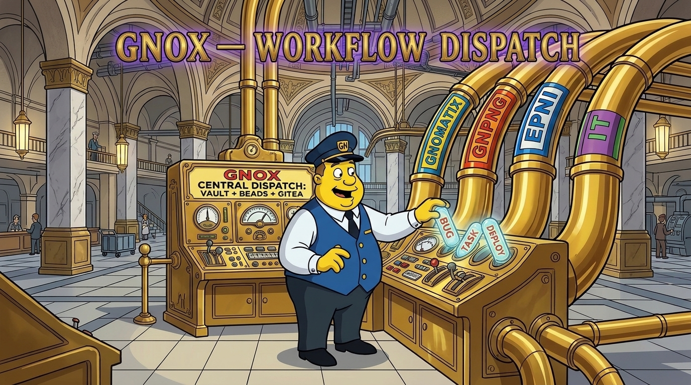

# gnox



One namespace for every skill in the `gnomatix-oss-skills` marketplace — plus a session-wide **GNOMATIX Namespacing Convention & Active Marketplace Topology** hook so every `gnox`-related skill uses the same scoping, callout, discovery, and routing rules automatically. Type `/gnox:` to see every routed command.

| Command | Runs |
|---|---|
| `/gnox:<plugin>` | the plugin's main skill, the one named like the plugin (for example `/gnox:hidden-libel-check`); for a plugin without one, a list of its commands |
| `/gnox:<plugin>:<skill>` | any other skill of the plugin (for example `/gnox:python-elimination-program:zartan`) |
| `/gnox:<plugin>:<group>:<cmd>` | the plugin's own sub-command `/<plugin>:<group>:<cmd>`, from its `commands/<group>/<cmd>.md`, at any depth |
| `/gnox:migrate` | reconciles user/project install state across historical plugin and skill renames or consolidations (`scripts/install-skills.js migrate`) |

Each command hands its arguments to the plugin's own skill, so the target plugin has to be installed when you invoke its routed command. Every plugin still installs and runs stand-alone under its own `/<plugin>` command whether or not `gnox` is installed.

## Session-Wide GNOMATIX Namespacing Convention & Active Topology

When `gnox` is installed, its `SessionStart` and `PostCompact` hooks ([`hooks/session-namespace.js`](hooks/session-namespace.js)) — together with [`skills/gnox/SKILL.md`](skills/gnox/SKILL.md) on non-hook agents — establish both the **GNOMATIX Namespacing Convention** and **Active Marketplace Topology** for the working session:

1. **Hierarchical Path & Config Scoping (`workspace_root:subdir:...`)**:
   - Detects `workspace_root` from the active repository (`.claude/readme-images.json`, `.claude-plugin/marketplace.json`, `package.json`, or directory name).
   - Scopes subdirectory configurations, style guides (`update-readme-images`), and rules along colon-delimited chains (`<workspace_root>:plugins:<name>`, `<workspace_root>:packages:<pkg>`) with top-down inheritance from `<workspace_root>`.
2. **CLI-Safe Callouts & 4-Step Namespace Resolution (`[NS]{@target}`)**:
   - Standardizes asynchronous notifications, proposed-revision alerts, and action items as `[NS]{@target} <message> #domain #urgency #action` (avoiding bare `@person` tokens that trigger CLI file-attachment parsers).
   - Enforces the 4-step resolution rule: explicit `[NS]` → active task/Bead namespace → directory/`up:` chain → `[UNRESOLVED] #needs-namespace` (never guessing silently).
3. **Inline Entity Grounding (`«term» [CURIE]`)**:
   - Grounds specific named entities on first mention using silent guillemets and Bioregistry CURIEs (`ontology-lookup` + `inaudible-markup`).
4. **Active Marketplace Topology Discovery (`hooks/lib/gnox-discovery.js`)**:
   - Detects installed `gnomatix-oss-skills` plugins across Claude Code (`~/.claude/plugins/`), cross-CLI Agent Skills directories (`.agents/skills/`, `.kiro/skills/`, `.github/skills/`, `~/.gemini/config/plugins/`), and workspace `plugins/`, plus optional local tools (`mise`, `magick`, `bd`, `gws`, `git-crypt`) on `PATH` and `mise` shims.
   - Injects a concise session summary of active complementary pairings (`gnox<->satori`, `update-readme-images<->og-social-image`, `inaudible-markup<->ontology-lookup`, `spank-dario<->dont-be-hitler`, etc.) while instructing the model to run documented Tier 0 standalone fallbacks cleanly whenever a companion plugin or optional tool is absent.
5. **Atomic Git-Flow River Steering (*"Be the River, Not the Rock"*)**:
   - Steers session version-control discipline toward short-lived, fit-to-purpose `feature/<topic>` and `bugfix/<topic>` branches, verified atomic commits, and high-priority direct merge + push to `develop` / `main` as soon as verified (honoring any explicit repository or user commit/push gate).
   - Identifies long-lived divergent branches, sprawling unpushed local working trees, and unauthorized Pull Requests as flow-obstructing "rocks" across bionic-team work — and when paired with **`satori`**, directs the agent to flag and resolve any drift toward those rocks as an observable `satori` incompatibility.

## Stand-Alone & Complementary Plugins

- **Stand-alone**: `gnox` installs cleanly on its own (`node` only) and injects the GNOMATIX Namespacing Convention, Atomic Git-Flow River Steering, and topology discovery with zero sibling plugins required.
- **Complements when installed**:
  - **Every marketplace plugin**: exposes `/gnox:<plugin>[:<skill>]` routing and shares `workspace_root:subdir:...` config scoping and `[NS]{@target}` callout formatting.
  - **`satori`**: pairs `gnox`'s Atomic Git-Flow River Steering (*"Be the river, not the rock"*) with `satori`'s per-turn symbolic flow reminder so unmerged branches, unpushed worktrees, and unauthorized PRs are recognized and cleared immediately.
  - **`skill-vv`**: pairs topology discovery with per-skill `VV.md` requirement checks and model/platform verification state.
  - **`update-readme-images`**, **`inaudible-markup`**, **`ontology-lookup`**, and **`critical-control-points`**: consume the session's `workspace_root` namespace, `[NS]{@target}` callouts, and `«term» [CURIE]` rules directly.

## Optional Local Tools (`mise` MCP Server)

`gnox`'s command routing and `SessionStart` / `PostCompact` hook require only `node`. Installing the optional **`mise`** CLI unlocks `gnox`'s safe-mode MCP server (`.mcp.json`): Claude Code starts `mise --cd <project> mcp`, so the model can inspect the project's `mise` tools, tasks, and config (`mcp__plugin_gnox_mise__*`). It runs in safe mode (`MISE_SAFE=1`): environment values are redacted so no secrets reach the model, and `run_task` refuses to execute, while `install_tool` remains available for trusted projects (`mise trust`).

When `skill-vv` is installed, it checks [`VV.md`](VV.md) and offers the standard marketplace installers in `deps/` if `mise` is not yet on `PATH`:

```sh
curl -fsSL https://raw.githubusercontent.com/gnomatix/gnomatix-oss-skills/main/deps/mise.sh | sh
powershell -NoProfile -ExecutionPolicy Bypass -Command "irm https://raw.githubusercontent.com/gnomatix/gnomatix-oss-skills/main/deps/mise.ps1 | iex"
```

Both stop if `mise` is already installed, and ask before adding another copy.

## Naming convention

Claude Code builds every command from the plugin name first: a skill is `/<plugin>:<skill>`, and a file `commands/<dir>/<name>.md` is `/<plugin>:<dir>:<name>`. There is no alias or shared-prefix setting, and the marketplace name never appears in a command (only in install ids, `<plugin>@gnomatix-oss-skills`). The `gnox` plugin is how the marketplace gets one prefix: its commands are generated as `/gnox:<plugin>[:<skill>]`.

Rules for every plugin in this marketplace, so the generated names stay regular:

- Plugin names: lowercase kebab-case (letters, digits, `-`). No `:`, `@`, spaces or path separators (Claude Code refuses them), and none of Claude Code's reserved names or prefixes (`claude-`, `anthropic-`, `cc-plugin-` and the rest).
- A plugin's main skill takes the plugin's own name, so `/gnox:<plugin>` runs it.
- Every other skill gets a short lowercase kebab-case name, unique within its plugin; it becomes `/gnox:<plugin>:<skill>`.
- A plugin with sub-commands routes them itself: `commands/<group>/<cmd>.md` is its own `/<plugin>:<group>:<cmd>`, and gnox mirrors it as `/gnox:<plugin>:<group>:<cmd>`. Group and command file names are lowercase kebab-case; a skill and a command don't share a name (if they do, the gnox command goes to the skill).
- Names never contain `:`; the colon is only the separator Claude Code adds.

## Keeping it current

The commands are generated from `.claude-plugin/marketplace.json`, each plugin's `skills/<skill>/SKILL.md` (its `name` and the first sentence of its `description`) and each plugin's `commands/**/*.md`, and the zero-dependency `hooks/lib/` modules are synced from root `lib/`:

```sh
node scripts/sync-lib.js --check                      # verify synced hooks/lib/ helpers
node plugins/gnox/scripts/build-commands.js           # write plugins/gnox/commands/
node plugins/gnox/scripts/build-commands.js --check   # exit 1 if anything is out of date
node plugins/gnox/test/run.js                         # run full router, topology, + hook V&V suite
```

Run `build-commands.js` after adding, renaming or removing a plugin or a skill. A file under `commands/` without the generated marker is left alone.

<!-- BEGIN: gnomatix-license-include -->
## License

**[Business Source License 1.1](https://github.com/gnomatix/gnomatix-oss-skills/blob/main/LICENSE)** (`BUSL-1.1`). The source is available, but this is not OSI open source.

**Commercial use is strictly prohibited without a paid commercial licensing / usage agreement with GNOMATIX.** Use by or for any government, government agency or charity is commercial use. Contact GNOMATIX first to arrange either of these:
- an ongoing support & development agreement
- a reasonable one-time usage fee, paid via [Buy Me a Coffee](https://www.buymeacoffee.com/gnomatix)

Both support continued development work on GNOMATIX projects. Contact: [`sales@gnomatix.com`](mailto:sales@gnomatix.com) or [LinkedIn](https://www.linkedin.com/company/gnomatix). General product support: [`support@gnomatix.com`](mailto:support@gnomatix.com).

The full terms, including the Additional Use Grant, the Change Date and the Change License, are in [`LICENSE`](https://github.com/gnomatix/gnomatix-oss-skills/blob/main/LICENSE).
<!-- END: gnomatix-license-include -->
