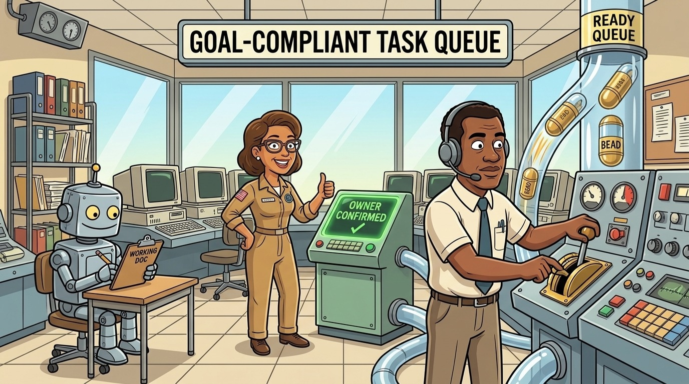

# goal-compliant-task-queue



Brett Whitty's question / task / record protocol, as a tested tool. Each question Brett asks becomes a session task and one working document. The agent works it in the document; Brett ticks and comments there; the agent asks "Have I sufficiently responded to your question?"; and only after his "yes" is a bead created.

Brett's specification, verbatim: [`skills/goal-compliant-task-queue/references/brett-spec.md`](skills/goal-compliant-task-queue/references/brett-spec.md). The design, data flow and requirement traceability: [`docs/system-design.md`](docs/system-design.md).

## What you get (Brett)

- **One working document per open question** on claude.ai: your question verbatim, then the agent's answer, plan and findings as sections. Every section has a "Brett confirms" tick that only you can set (the page's store lets only the owner write), a USER COMMENT box, FULL CONTEXT, and SUPPORTING MATERIALS as emoji links with hover text. "Comment on this section" opens claude.ai's own comment composer on that section.
- **A hub page** on claude.ai with a tab per open question: oldest (active) first, a ● on any question whose answer is ready but which you have not been asked about, each tab showing the same sections, ticks and comments, and a link to the question's own document.
- **A pane in Claude Code** (`/worklog-pane`) with the same tabs and content, from the same data.
- **`/worklog`** shows where your open questions stand and refreshes the hub; **`/worklog-status`** reports the checks and metrics without changing anything.
- **Beads only after "yes".** The tool refuses to create a record before you have answered "yes", and never creates two.

Comments are typed in the working document; there is no comment slash command.

## What the agent does

The skill gives the procedure, step by step, with the A-numbers each step implements. The agent does the judgment (is it a question, is it answered); the `worklog` tool does the programmatic work the same way every time:

| Step | Command (CLI) | MCP tool |
|---|---|---|
| Log each prompt verbatim, id `P-YYYYMMDD-NNN-<sess4>` | `worklog log --source user --text-file F` | `worklog_log` |
| Open a question's document | `worklog open <slug> --subject "…" --quote-file F --task-id N` | `worklog_open` |
| Write a section | `worklog section <slug> <n> --title T --body-file F [--context-file F] [--material "label\|uri\|emoji"]` | `worklog_section` |
| Build the page, capabilities and ArtifactData files | `worklog artifact-payload <slug>` / `--hub` | `worklog_artifact_payload` |
| Record the page URL | `worklog link <slug> --url U` / `--hub --url U` | `worklog_link` |
| Merge Brett's ticks and comments (default D: `<state>/pulls/<slug>`) | `worklog pull <slug> [--from-dir D]` / `--hub` / `--pane` | `worklog_pull` |
| Unlock a page Brett sent (prints the ArtifactData delete of `review/_lock`) | `worklog unlock <slug>` / `--hub` | `worklog_unlock` |
| The ask, and his reply verbatim | `worklog asked <slug>`; `worklog answer <slug> --text-file F` | `worklog_asked`, `worklog_answer` |
| Bead, only after "yes" | `worklog resolve <slug>` | `worklog_resolve` |
| Decision / clarification record, once resolved | `worklog archive <slug>` | `worklog_archive` |
| Snapshot of the state dir | `worklog snapshot` | `worklog_snapshot` |
| Read the event log | `worklog log-show [--slug S] [--since T]` | `worklog_log_show` |
| Tell this session that local state changed | `worklog watch` (long-running); `worklog-notify "<text>"` | |
| Pane / hub data | `worklog sync` | `worklog_sync` |
| Checks and metrics | `worklog status`, `worklog metrics` | `worklog_status`, `worklog_metrics` |
| The full record of one question | `worklog show <slug>` | `worklog_show` |
| The config as the tool reads it | `worklog config` | |

Run the CLI as `node "${CLAUDE_PLUGIN_ROOT}/scripts/worklog" …`. Exit code 2 means a rule in the spec refused the operation.

The tool cannot reach claude.ai. The agent publishes the pages with its Artifact tool (with the capabilities `artifact-payload` writes), writes their stores with ArtifactData, and reads Brett's review back with an ArtifactData `list … out_dir`, which `pull` merges.

Local first (A60-A62): every store read goes to `out_dir = <state>/pulls/<slug>` (hub: `<state>/pulls/hub`), which is also `pull`'s default, and every page `artifact-payload` builds is kept at `<state>/pages/<slug>.html` (hub: `pages/hub.html`). Your work product is on the local filesystem first.

## Send to Claude, lock and archive (A58, A59)

- "Send my updates to Claude" (both page templates; needs the full `comments` capability, which `CAPABILITIES` declares) first writes `review/_lock` = `{locked: true, at}`, then posts Brett's ticks and comments as one `BRETT-UPDATES {…}` comment (at most 3900 bytes; comments are cut, step by step, if needed). While `review/_lock` exists the page is read-only and shows "Sent to Claude at <time>: read-only until Claude has reviewed it." It follows the doc live, so it unlocks as soon as the agent deletes it (`worklog unlock` prints that call). If the send fails, the page removes the lock again.
- A resolved question's page shows "Archived work log" and is read-only for good.
- `worklog archive <slug>` (only once resolved) writes `<state>/archive/<yyyy-mm-dd>-<slug>.md`: YAML front matter (`kind: decision-clarification`, key, subject, status, opened/asked/answered/resolved times, bead, document URL, author, reporter, tags), Brett's question, every section with his tick and USER COMMENT, the ask/answer history and the final "yes". His words sit in fenced blocks byte-exact (the fence is longer than any backtick run in them). The agent copies the file to the vault Inbox and the Drive `worklog/archive/` folder.

## The watcher (A60-A62)

`worklog watch` watches `<state>/questions` and `<state>/pulls` with `fs.watch` (no polling), waits until a question has been quiet for 30 s (`GCTQ_WATCH_DEBOUNCE_MS`), then sends "worklog: <slug> changed" to the session with `scripts/worklog-notify`. That posts to the session's messaging socket: `CLAUDE_CODE_MESSAGING_SOCKET` (a unix socket path) and `CLAUDE_CODE_MESSAGING_TOKEN`, which each Claude Code session exports; the client sends `{"type":"auth","token":"<token>"}` on the first line, then the text. The agent starts it at session start under PM2, passing the session's socket and token, for example in `~/.config/pm2/ecosystem.config.cjs`:

```js
module.exports = { apps: [{
  name: 'worklog-watch',
  script: process.env.HOME + '/.claude/plugins/cache/gnomatix-oss-skills/goal-compliant-task-queue/0.1.0/scripts/worklog', // the installed plugin's scripts/worklog
  args: 'watch',
  interpreter: 'node',
  autorestart: true,
  env: {
    CLAUDE_CODE_MESSAGING_SOCKET: process.env.CLAUDE_CODE_MESSAGING_SOCKET,
    CLAUDE_CODE_MESSAGING_TOKEN: process.env.CLAUDE_CODE_MESSAGING_TOKEN,
    GCTQ_STATE: process.env.GCTQ_STATE, // only if the state dir is not the default
  },
}] }
```

Start or restart it from the session (so the env carries that session's socket and token): `pm2 startOrRestart ~/.config/pm2/ecosystem.config.cjs --only worklog-watch --update-env`.

## Where your data and logs are (A64)

Everything is local, under the state directory `$GCTQ_STATE` (default `${XDG_STATE_HOME:-~/.local/state}/goal-compliant-task-queue/`):

| Path | What |
|---|---|
| `questions/<slug>.json` | each question: his words, sections, ticks and comments, asks, replies, records |
| `prompts/YYYY-MM-DD.jsonl` | every prompt logged verbatim |
| `log/events.jsonl` | the event log: one JSON line per state change (time, actor, command, slug, exact arguments, result); appended, never rewritten; `worklog log-show` reads it |
| `snapshots/<UTC stamp>.tar.gz` | snapshots of the whole state dir (`worklog snapshot`, and automatically after every pull, resolve and archive); the last 20 are kept |
| `pulls/<slug>/review/*.json`, `pulls/hub/` | what the pages' stores held at the last ArtifactData list (Brett's ticks and comments, and `_lock`) |
| `pages/<slug>.html`, `pages/hub.html` | the page HTML as last built for publishing |
| `docs/<slug>/payload/`, `hub/` | publish payloads: page, capabilities, items, batch |
| `docs/<slug>/bead-body.md` | the bead description written at resolve |
| `archive/<yyyy-mm-dd>-<slug>.md` | decision / clarification records |
| `worklog.json`, `hub.json` | the pane / hub data and the hub URL |

The config is read from `$GCTQ_CONFIG` (below). The Claude Code pane keeps its own small state (`goal-compliant-task-queue.log`, `.selected`, `.ticks`) in the mod's state store. PM2 keeps the watcher's stdout and stderr in `~/.pm2/logs/worklog-watch-*.log`.

## No hooks

Nothing here intercepts prompts, tool calls or stops. `hooks/hooks.json` loads one Claude Code mod module, `hooks/register.tsx`, which registers `/worklog-pane`, reloads `worklog.json` on session start and on `/worklog-pane` (no polling, A49), and renders the pane. It handles only `session.start`, `command.run` for its own command, and `ui.render` for its own pane.

## State and config

- State: `$GCTQ_STATE`, default `${XDG_STATE_HOME:-~/.local/state}/goal-compliant-task-queue/`: see "Where your data and logs are" above. The tool writes nowhere else.
- Config (Brett edits it; the tool only reads and validates it): `$GCTQ_CONFIG`, default `${XDG_CONFIG_HOME:-~/.config}/goal-compliant-task-queue/config.json`, keys `enabled`, `required_skills`, `optional_skills`, `subagents`, `curator` (`enabled`, `subagent`). With `"enabled": false`, or any config error, every write is refused.
- `GCTQ_BD` (default `bd`) and `GCTQ_ACTOR` (default `claude-cli`) set the beads command and actor; `GCTQ_SESSION` the session id for prompt ids; `GCTQ_NOW` (an ISO date) pins the clock, for tests.

## Optional curator

`agents/task-queue-curator.md`: when `curator.enabled` is true, the agent launches it in the background to check every question has a task and a document, nothing was recorded before "yes", and Brett's words were kept verbatim. It reports to the main agent only.

## Implementation notes

- Node built-ins only; no npm dependencies. Each write is a temp file plus rename inside the state directory, under a lock file (stale after 60 s), with retries on EBUSY/EPERM. This plugin has one process writing at a time, so it implements these patterns inline instead of vendoring `write-file-atomic` / `proper-lockfile`.
- Brett's words are stored exactly as read: no trimming or newline changes. Only the "yes" comparison trims and ignores case.
- The page template is one dependency-free HTML file, `templates/working-document.html`, for both the hub and the documents; content goes in as JSON in a `<script type="application/json">` element, so his text cannot break the page.
- `templates/working-document.react.html` is a React/Tailwind/shadcn build of the same page (same `gctq-data` placeholder, same store contract, plus a "Send my updates to Claude" button); `worklog artifact-payload <slug>|--hub --react` uses it. The HTML template stays the default.

## Tests

```sh
node --test plugins/goal-compliant-task-queue/tests/*.test.mjs   # CLI, MCP server, pages
claude plugin test plugins/goal-compliant-task-queue                    # the pane
claude plugin validate plugins/goal-compliant-task-queue
```

The tests run the real CLI in a sandbox (own HOME, XDG dirs, cwd and state) with `bd` replaced by a mock, and check that nothing is written outside the state directory.

## Install

```sh
/plugin install goal-compliant-task-queue@gnomatix-oss-skills
```

## License

BUSL-1.1, as the other plugins in this marketplace.
