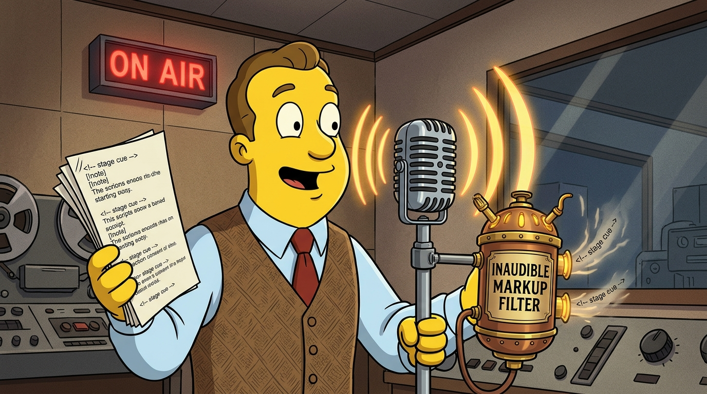

# inaudible-markup



> An [Agent Skill](https://agentskills.io) that writes each reply as a structured script with markup a text-to-speech voice does not read aloud, plus callouts and tags that say who a line is for and what it is. Spoken, it sounds natural; read back, it has headings, lists, scope and tags.

For anyone whose conversations are read later by a person, another model or a knowledge-capture pipeline, and for every conversation held in voice mode.

<!-- BEGIN: gnomatix-promo-include -->
<p>
  <a href="https://www.buymeacoffee.com/gnomatix">
    
  </a>
</p>

<!-- For JS-rendering contexts (the BMC-supplied script tag, preserved as authored):
<script type="text/javascript"
  src="https://cdnjs.buymeacoffee.com/1.0.0/button.prod.min.js"
  data-name="bmc-button"
  data-slug="gnomatix"
  data-color="#BD5FFF"
  data-emoji=""
  data-font="Cookie"
  data-text="Buy me a coffee"
  data-outline-color="#000000"
  data-font-color="#ffffff"
  data-coffee-color="#FFDD00"></script>
-->
<!-- END: gnomatix-promo-include -->

## Skills

| Skill | Role |
|---|---|
| [`inaudible-markup`](skills/inaudible-markup/SKILL.md) | Lists the characters tested silent in voice mode and the spoken ones to avoid, gives the callout (`{@person}`) and tag (`#word`) forms and the namespace resolution rule, and labels passages as `{Decision}`, `{Request}`, `{Definition}`, `{Open question}` or `{Correction}`. Names `ontology-lookup` as the companion for identifiers. |

## Why

A voice reply and a log entry are the same text. Ordinary markdown reads badly aloud, and plain speech leaves a log with no structure. Marks that the voice does not pronounce let one text serve both: the listener hears words, and the log keeps sections, ordered lists, scope, addressees and tags.

The silent set was tested by Brett Whitty in a voice-mode session on 2026-06-28. Characters not tested are not assumed silent.

## Install

### Claude Code

From the parent marketplace repo:

```sh
/plugin marketplace add gnomatix/gnomatix-oss-skills
/plugin install inaudible-markup@gnomatix-oss-skills
```

### Manual Claude Code install

```sh
mkdir -p ~/.claude/skills
cp -r plugins/inaudible-markup/skills/* ~/.claude/skills/
```

### Other CLIs (cross-CLI Agent Skills standard)

The [`skills/`](skills/) subdirectory follows the cross-CLI [Agent Skills](https://agentskills.io) standard. Each CLI has its own install location — see the parent repo's README for per-CLI pointers, or each CLI's documentation.

## Layout

```
plugins/inaudible-markup/
├── .claude-plugin/
│   └── plugin.json
├── README.md
└── skills/
    └── inaudible-markup/
        └── SKILL.md
```

<!-- BEGIN: gnomatix-license-include -->
## License

**[Business Source License 1.1](https://github.com/gnomatix/gnomatix-oss-skills/blob/main/LICENSE)** (`BUSL-1.1`). The source is available, but this is not OSI open source.

**Commercial use is strictly prohibited without a paid commercial licensing / usage agreement with GNOMATIX.** Use by or for any government, government agency or charity is commercial use. Contact GNOMATIX first to arrange either of these:
- an ongoing support & development agreement
- a reasonable one-time usage fee, paid via [Buy Me a Coffee](https://www.buymeacoffee.com/gnomatix)

Both support continued development work on GNOMATIX projects. Contact: [`sales@gnomatix.com`](mailto:sales@gnomatix.com) or [LinkedIn](https://www.linkedin.com/company/gnomatix). General product support: [`support@gnomatix.com`](mailto:support@gnomatix.com).

The full terms, including the Additional Use Grant, the Change Date and the Change License, are in [`LICENSE`](https://github.com/gnomatix/gnomatix-oss-skills/blob/main/LICENSE).
<!-- END: gnomatix-license-include -->
