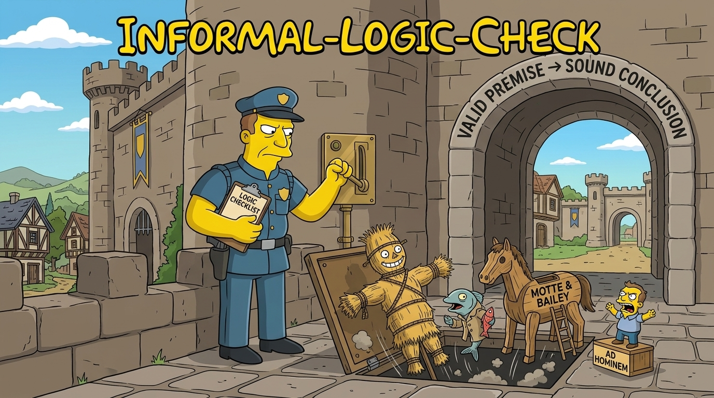

# informal-logic-check

> An [Agent Skill](https://agentskills.io) for the moment the agent is about to disagree with you, qualify what you said, or push back; for the moment you insult or swear at it; and for any moment it considers ending the conversation. It audits its own last output first, confirms your conclusion and premises in your own words, and only then evaluates, premise by premise.

<!-- BEGIN: gnomatix-promo-include -->

  

<!-- For JS-rendering contexts (the BMC-supplied script tag, preserved as authored):

-->
<!-- END: gnomatix-promo-include -->

## Skills

- `informal-logic-check`: three triggers and three phases. **Trigger A**, disagreement: any reply that would rebut, qualify or correct something you argued. **Trigger B**, an insult or escalating profanity aimed at the agent: treated as a severity signal that its last output has a defect, never as abuse. **Trigger C**, the end-conversation gate: the whole skill runs before ending a conversation is even considered. **Phase 0** audits the agent's own previous output against nine checks (reframing, cherry-picking, caveat earmarking, ranking, burden-shifting, attributed states, unverified authority, standing-rule violations, instruction drift) and fixes what it finds. **Phase 1** quotes your conclusion and premises in your own words and asks whether that is your argument. **Phase 2** evaluates only the confirmed set: structure, acceptability, relevance, sufficiency, and a fallacy check on the draft reply itself.

## Install

- Claude Code: `/plugin install informal-logic-check@gnomatix-oss-skills`, then `/informal-logic-check` or `/gnox:informal-logic-check`. The skill loads through its description on each platform; `VV.md` records where that has been verified.
- Every other agent: install the static Agent Skills folder (`plugins/informal-logic-check/skills/informal-logic-check/`) with `node scripts/install-skills.js install --plugin informal-logic-check` from the marketplace root (supports Codex, Antigravity `agy`, GitHub Copilot, VS Code, Cursor, OpenCode, and Kiro).

## Hooks

None. The skill's triggers are in its description, which agents that support the Agent Skills format load at startup; nothing runs at session start or on each prompt.

## Verification and validation

`VV.md` lists the two V&V procedures (the insult self-audit and the disagreement gate) and the record of where they have passed.

<!-- BEGIN: gnomatix-license-include -->
## License

**[Business Source License 1.1](https://github.com/gnomatix/gnomatix-oss-skills/blob/main/LICENSE)** (`BUSL-1.1`). The source is available, but this is not OSI open source.

**Commercial use is strictly prohibited without a paid commercial licensing / usage agreement with GNOMATIX.** Use by or for any government, government agency or charity is commercial use. Contact GNOMATIX first to arrange either of these:
- an ongoing support & development agreement
- a reasonable one-time usage fee, paid via [Buy Me a Coffee](https://www.buymeacoffee.com/gnomatix)

Both support continued development work on GNOMATIX projects. Contact: [`sales@gnomatix.com`](mailto:sales@gnomatix.com) or [LinkedIn](https://www.linkedin.com/company/gnomatix). General product support: [`support@gnomatix.com`](mailto:support@gnomatix.com).

The full terms, including the Additional Use Grant, the Change Date and the Change License, are in [`LICENSE`](https://github.com/gnomatix/gnomatix-oss-skills/blob/main/LICENSE).
<!-- END: gnomatix-license-include -->
