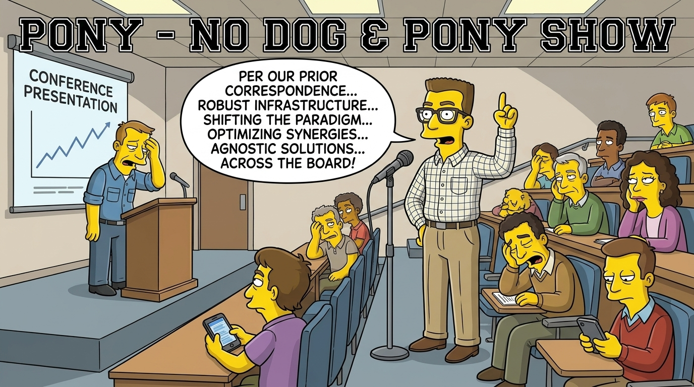

# pony

> An [Agent Skill](https://agentskills.io) that gives you a one-token flag for a reply that performed instead of answering: `/pony 7`. No note needed; the agent finds the passage, names the rule it broke, logs it with the severity you gave, re-answers plainly, and stops. The name is "dog and pony show".

<!-- BEGIN: gnomatix-promo-include -->

  

<!-- For JS-rendering contexts (the BMC-supplied script tag, preserved as authored):

-->
<!-- END: gnomatix-promo-include -->

## Skills

- `pony`: showboating is explaining your own systems back to you, pronouncing on what your hardware can do, hedging or verifying what you said, compliments, quips, flourishes and pace nudges, advice framing, or answering a different question to show range. `/pony N` (N from 1 to 11; absent means unrated) makes the agent quote the passage, name the rule, log the instance to the project's `feedback_professional-courtesy.md` memory (or `~/.local/state/pony/log.md` where the project has no memory directory) with `#showboating`, `#sbN` and a subgenre tag (`#ego`, `#pomp`), re-answer in one or two sentences, and stop. The burden of proof is on the agent.

## Install

- Claude Code: `/plugin install pony@gnomatix-oss-skills`, then `/pony 7` or `/gnox:pony 7`.
- Every other agent: the skill folder `plugins/pony/skills/pony/` is in the Agent Skills format and is linked from `.agents/skills/` and `.kiro/skills/` at the root of this repository.

## Hooks

None. The skill runs when `/pony` is sent; nothing runs at session start or on each prompt.

## Verification and validation

`VV.md` lists the two V&V procedures (a rated flag and an unrated one) and the record of where they have passed.

<!-- BEGIN: gnomatix-license-include -->
## License

**[Business Source License 1.1](https://github.com/gnomatix/gnomatix-oss-skills/blob/main/LICENSE)** (`BUSL-1.1`). The source is available, but this is not OSI open source.

**Commercial use is strictly prohibited without a paid commercial licensing / usage agreement with GNOMATIX.** Use by or for any government, government agency or charity is commercial use. Contact GNOMATIX first to arrange either of these:
- an ongoing support & development agreement
- a reasonable one-time usage fee, paid via [Buy Me a Coffee](https://www.buymeacoffee.com/gnomatix)

Both support continued development work on GNOMATIX projects. Contact: [`sales@gnomatix.com`](mailto:sales@gnomatix.com) or [LinkedIn](https://www.linkedin.com/company/gnomatix). General product support: [`support@gnomatix.com`](mailto:support@gnomatix.com).

The full terms, including the Additional Use Grant, the Change Date and the Change License, are in [`LICENSE`](https://github.com/gnomatix/gnomatix-oss-skills/blob/main/LICENSE).
<!-- END: gnomatix-license-include -->
