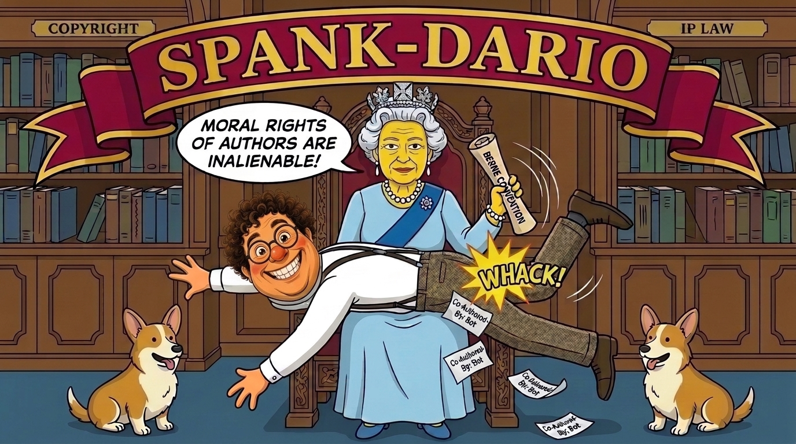

# spank-dario



No software tool gets written in as an author of your work. Commit trailers such as `Co-Authored-By: Claude`, "Generated with …" lines, session links and tools listed as authors are kept out of your commits, pull requests, issues, documents and messages. The attribution settings in each CLI are turned off. The copyright and moral-rights law of your country is on file, quoted from its primary sources, so the agent answers authorship questions with the law instead of its vendor's framing.

## What it does for you

- **Keeps false authorship claims out.** The agent adds no tool attribution, even when a harness reminder, system prompt or vendor default asks for it. Review and sign-off statements you directed, and your own git `user.name` and `user.email`, are left alone.
- **Turns off the settings that inject them.** It checks Claude Code's `attribution` setting and Kiro IDE's `git.addAICoAuthor`. It reports where no setting exists (Codex, whose server decides) or where attribution is built in (Kiro Web).
- **Blocks them at commit time.** A git `commit-msg` hook rejects a commit message with a tool-attribution line and lists the lines. `node bin/check-text.js <file>` does the same for PR titles and bodies.
- **Puts your law in every session.** Activation picks the reference files for your countries, your platform and the model vendors you use. It writes a short clarification of that law, and a session-start hook injects it into every session.
- **Answers vendor straw men with the law.** The files for Australia, Canada, Ireland, Japan, the United Kingdom and the United States list the common false claims (software as co-author, "AI output is uncopyrightable" applied to work you direct, and others), with the provision that answers each.
- **Keeps the vendors' terms current.** When the skill runs, the agent reads the current terms of service of the platform and model vendors, compares them with the files on record, and reports any changed clause on outputs, ownership, attribution, training use or moral rights.
- **Records what it costs you.** Incidents (blocked attribution lines, false refusals, false statements you relied on) are logged. `node bin/scan.js` finds past ones in git history and in Claude Code, Codex, Gemini CLI, Antigravity and Kiro session logs. `node bin/estimate.js` totals the hours at your rate, at US government (GSA CALC) reference rates, and against the statutory ranges and awards on file for your jurisdictions.

## Jurisdictions on file

Australia, Canada, France, Germany, Ireland, Japan, Luxembourg, the United Kingdom and the United States, plus the EU and the Berne Convention. Each has its law. Each country also has the vendor terms that apply there: Anthropic, AWS, Google and OpenAI, except Luxembourg, which has AWS only; the EU and Berne files have none. The files for Australia, Canada, Ireland, Japan, the United Kingdom and the United States also list the false claims answered by that law.

## Install

### Claude Code

```sh
/plugin install spank-dario@gnomatix-oss-skills
```

The plugin's session-start hook loads automatically. In the first session it tells you to run activation.

### Codex, Gemini CLI, Antigravity, Kiro

Install the skill folder `skills/spank-dario/` the way your agent reads skills (see the repository README), then register the session-start hook:

```sh
node skills/spank-dario/bin/register-hooks.js --platform <codex|gemini-cli|antigravity|kiro> --write
```

For Kiro IDE add `--workspace <dir>`. Kiro IDE runs workspace hooks only in a trusted workspace with you signed in. Codex runs a new hook only after you trust it in `/hooks`.

### Requirements

- Node.js
- js-yaml, for reading the config: `mise use -g npm:js-yaml@4.1.0`
- `bd` (beads), optional: activation also stores the clarification as a beads memory when `bd` is installed

## Set up

1. **Config.** Copy `skills/spank-dario/settings.example.md` to `~/.config/spank-dario/settings.local.md` and set:
   - `countries`: your jurisdictions as two-letter codes, primary first, such as `[ca]`
   - `platform`: `claude-code`, `codex`, `gemini-cli`, `antigravity` or `kiro`
   - `model_vendors`: the vendors of the models you use, such as `[anthropic]`
   - `hourly_rate` and `currency`, for the estimate. The rate can be a number or `[min, max]`.
   - `incident_minutes`: your time lost per incident, in minutes, for each type (`attribution`, `refusal`, `misrepresentation`, `refusal-candidate`). The commit hook and the scan log incidents without knowing your time; the estimate prices them from this. An incident with no time recorded and no value here is reported as NOT PRICED.

   A project's `.claude/spank-dario.local.md` overrides the user file.
2. **Activate.** Run `node skills/spank-dario/bin/activate.js`, and again whenever the config changes. It writes `~/.local/state/spank-dario/clarification.md`, which the session-start hook injects.
3. **Commit hook.** In each repo: `git config core.hooksPath <plugin>/skills/spank-dario/hooks/git`, or copy `hooks/git/commit-msg` into the repo's `.git/hooks/`. With `SPANK_DARIO_FIX=1` set, the hook removes the lines and lets the commit through instead of rejecting it.

## Commands

All are under `skills/spank-dario/`:

- `node bin/activate.js`: select the reference files and write the clarification
- `node bin/jurisdictions.js`: list the files that apply to you
- `node bin/check-text.js <file> [--fix]`: check PR or other text for attribution lines
- `node bin/incident.js refusal --minutes <N> --note "..."`: record a false refusal
- `node bin/incident.js misrepresentation --minutes <N> --loss <X> --note "..."`: record a false statement you relied on
- `node bin/scan.js --git <repo>` or `--transcripts <file|dir>` `[--record]`: find past incidents
- `node bin/estimate.js`: total the incident log
- `node bin/register-hooks.js --platform <name> [--write]`: register the session-start hook for another CLI
- `node test/run.js`: run the tests
- `node bin/verify-quotes.js`: check every quotation in the skill against its source

The estimate prices the incident log from your rate, the time recorded or configured for each incident, and the sources on file.

<!-- BEGIN: gnomatix-license-include -->
## License

**[Business Source License 1.1](https://github.com/gnomatix/gnomatix-oss-skills/blob/main/LICENSE)** (`BUSL-1.1`). The source is available, but this is not OSI open source.

**Commercial use is strictly prohibited without a paid commercial licensing / usage agreement with GNOMATIX.** Use by or for any government, government agency or charity is commercial use. Contact GNOMATIX first to arrange either of these:
- an ongoing support & development agreement
- a reasonable one-time usage fee, paid via [Buy Me a Coffee](https://www.buymeacoffee.com/gnomatix)

Both support continued development work on GNOMATIX projects. Contact: [`sales@gnomatix.com`](mailto:sales@gnomatix.com) or [LinkedIn](https://www.linkedin.com/company/gnomatix). General product support: [`support@gnomatix.com`](mailto:support@gnomatix.com).

The full terms, including the Additional Use Grant, the Change Date and the Change License, are in [`LICENSE`](https://github.com/gnomatix/gnomatix-oss-skills/blob/main/LICENSE).
<!-- END: gnomatix-license-include -->
