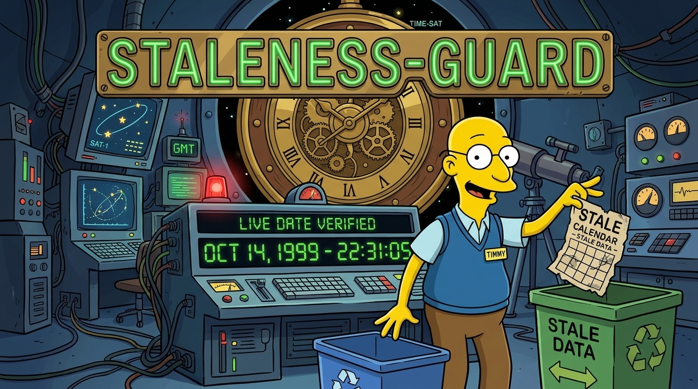

# staleness-guard

> An [Agent Skill](https://agentskills.io) that stops the agent answering from confidence. Any claim about the present-day world, your local environment, the agent's own platform and tools, or your uploaded and mounted material gets verified with the tool that can verify it before it is stated. If a relevant tool exists and is not used, the claim is not made.

<!-- BEGIN: gnomatix-promo-include -->

  

<!-- For JS-rendering contexts (the BMC-supplied script tag, preserved as authored):

-->
<!-- END: gnomatix-promo-include -->

## Skills

- `staleness-guard`: seven categories where answering from training-data confidence is dangerous (present state of the world; software and APIs; the user's local ground truth; the agent's own capabilities; moving-consensus domains; exact specifics; source material treated as authority), one rule for all of them, and the tool that fits each claim. It also covers thorough source review with a Last-Modified/Expires ledger, how to judge a fact's durability without faking it, the supersession trap (authority is per artifact, not per workspace), and the apology reflex as a trigger: emit the corrective action, not the story.
- `staleness-guard.index.md`, beside the skill: the companion register with the staleness ledger, the V&V queue and the use-case catalog. An installed copy is read-only, so the live register is kept at `~/.local/state/staleness-guard/index.md`, seeded from the shipped file on first use.

## Install

- Claude Code: `/plugin install staleness-guard@gnomatix-oss-skills`, then `/staleness-guard` or `/gnox:staleness-guard`. The skill loads through its description on each platform; `VV.md` records where that has been verified.
- Every other agent: the skill folder [`plugins/staleness-guard/skills/staleness-guard/`](skills/staleness-guard/) follows the cross-CLI [Agent Skills](https://agentskills.io) format (`mise skills sync --prune`, or per-CLI install paths in the root `README.md`).

## Hooks

None. The skill's triggers are in its description, which agents that support the Agent Skills format load at startup; nothing runs at session start or on each prompt.

## Verification and validation

`VV.md` lists the two V&V procedures (local ground truth and the capability claim) and the record of where they have passed.

<!-- BEGIN: gnomatix-license-include -->
## License

**[Business Source License 1.1](https://github.com/gnomatix/gnomatix-oss-skills/blob/main/LICENSE)** (`BUSL-1.1`). The source is available, but this is not OSI open source.

**Commercial use is strictly prohibited without a paid commercial licensing / usage agreement with GNOMATIX.** Use by or for any government, government agency or charity is commercial use. Contact GNOMATIX first to arrange either of these:
- an ongoing support & development agreement
- a reasonable one-time usage fee, paid via [Buy Me a Coffee](https://www.buymeacoffee.com/gnomatix)

Both support continued development work on GNOMATIX projects. Contact: [`sales@gnomatix.com`](mailto:sales@gnomatix.com) or [LinkedIn](https://www.linkedin.com/company/gnomatix). General product support: [`support@gnomatix.com`](mailto:support@gnomatix.com).

The full terms, including the Additional Use Grant, the Change Date and the Change License, are in [`LICENSE`](https://github.com/gnomatix/gnomatix-oss-skills/blob/main/LICENSE).
<!-- END: gnomatix-license-include -->
