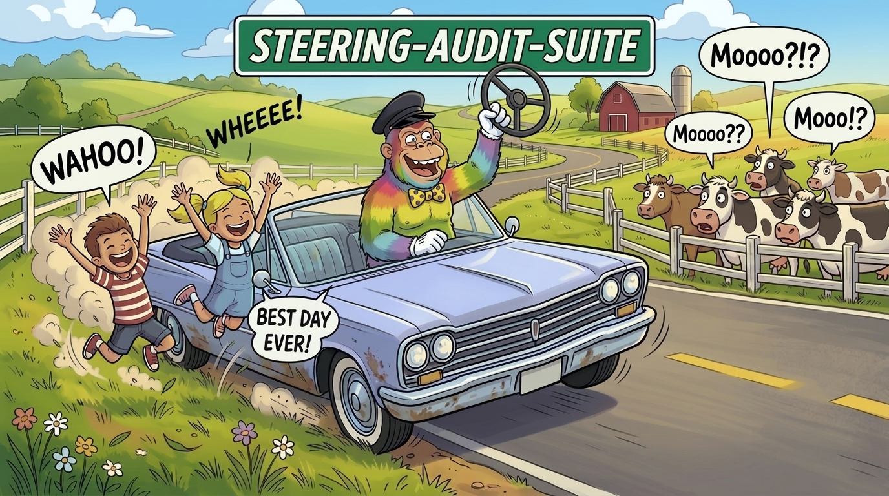

# steering-audit-suite

> [Agent Skills](https://agentskills.io) that audit the documents prescribing agent behaviour: rules, skills, workflows, and whole collections of them. A rule is only as good as the behaviour it produces; these audits catch the ways a compliant-looking actor follows the letter while violating the intent, and the structural problems around it: wrong document type for the content, vendor assumptions in supposedly portable skills, no graceful degradation between proprietary and self-hosted tools. Findings go to the document's owner; nothing is rewritten without authorization.

<!-- BEGIN: gnomatix-promo-include -->

  

<!-- For JS-rendering contexts (the BMC-supplied script tag, preserved as authored):

-->
<!-- END: gnomatix-promo-include -->

## Skills

- `steering-audit-suite`: the entry point when the document type isn't known. Classifies the document (RULE, SKILL, WORKFLOW, or a collection) and runs the matching audit. Its `references/` folder holds what every audit reads: the 15-check checklist, the document-type discriminators, the refactoring operations, the portability dimensions, where to find reference exemplars, and the report format.
- `audit-rule`: an always-on RULE document (CLAUDE.md, steering file, system prompt, `.cursorrules`, `.kiro/steering/*.md`). The checklist; no portability pass.
- `audit-skill`: an invocable SKILL document. The checklist, the reference-exemplar comparison, the portability and graceful-degradation audit, and the vendor's frontmatter checks (Claude Code, Cursor, Kiro, Antigravity).
- `audit-workflow`: a multi-step WORKFLOW: runbook, SOP, Kiro spec, Antigravity workflow, plan-mode document. The checklist, the phase-boundary checks (meaningful checkpoints, approval gates in the right place, defined inputs and artifacts), the portability audit.
- `audit-collection`: a directory of related documents. Per-document audits plus the cross-document pass: split, join, merge, clone and reformat proposals, conflicts, orphans, vendor coverage.
- `rule-audit`: the standalone single-file form of the suite, with its own checklist, exemplar, refactoring and portability sections. It overlaps the four skills above; it stays for use where the shared references don't resolve.

## Where it came from

The four `audit-*` skills and the shared references are the author's Steering Audit Suite, the 'steering' skills; `rule-audit` is the author's earlier user-level skill. The first-cut design notes are kept in `dev/steering-audit-suite/`.

## Install

- Claude Code: `/plugin install steering-audit-suite@gnomatix-oss-skills`, then `/steering-audit-suite`, `/steering-audit-suite:audit-rule` and the rest, or through gnox as `/gnox:steering-audit-suite` and `/gnox:steering-audit-suite:audit-rule`.
- Every other agent: the skill folders under [`plugins/steering-audit-suite/skills/`](skills/) follow the cross-CLI [Agent Skills](https://agentskills.io) format (`mise skills sync --prune`, or per-CLI install paths in the root `README.md`). The four audit skills reach the shared references as `../steering-audit-suite/references/`, which resolves directly whenever `steering-audit-suite` is installed beside them.

## Hooks

None. Every skill runs when invoked or when its description matches the request; nothing runs at session start or on each prompt.

## Verification and validation

`VV.md` lists the three V&V procedures (the self-audit, classify-and-route, and a collection refactor) and the record of where they have passed.

<!-- BEGIN: gnomatix-license-include -->
## License

**[Business Source License 1.1](https://github.com/gnomatix/gnomatix-oss-skills/blob/main/LICENSE)** (`BUSL-1.1`). The source is available, but this is not OSI open source.

**Commercial use is strictly prohibited without a paid commercial licensing / usage agreement with GNOMATIX.** Use by or for any government, government agency or charity is commercial use. Contact GNOMATIX first to arrange either of these:
- an ongoing support & development agreement
- a reasonable one-time usage fee, paid via [Buy Me a Coffee](https://www.buymeacoffee.com/gnomatix)

Both support continued development work on GNOMATIX projects. Contact: [`sales@gnomatix.com`](mailto:sales@gnomatix.com) or [LinkedIn](https://www.linkedin.com/company/gnomatix). General product support: [`support@gnomatix.com`](mailto:support@gnomatix.com).

The full terms, including the Additional Use Grant, the Change Date and the Change License, are in [`LICENSE`](https://github.com/gnomatix/gnomatix-oss-skills/blob/main/LICENSE).
<!-- END: gnomatix-license-include -->
