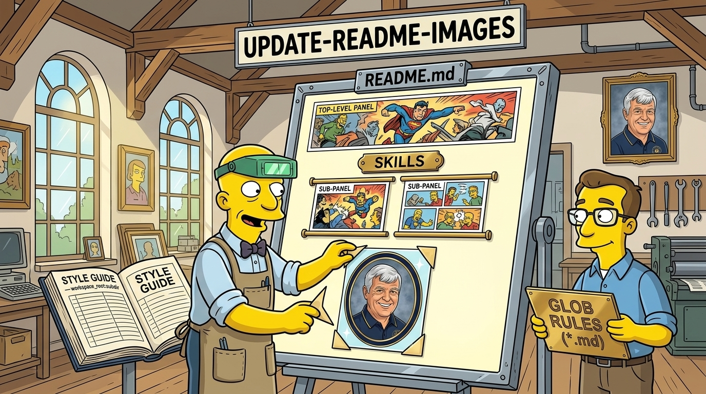

# update-readme-images



> A config-driven [Agent Skill](https://agentskills.io) and zero-dependency Node CLI for curating, generating, post-processing, embedding, and auditing `README.md` and `SKILL.md` imagery across a repository — with GNOX-namespaced style guides (`workspace_root:subdir:...`), glob-matched rules documents (`*`, `**`), automatic `og-social-image` generation across `assets/images` directories, and non-destructive `assets/drafts` staging for existing images.

<!-- BEGIN: gnomatix-promo-include -->
<p>
  <a href="https://www.buymeacoffee.com/gnomatix">
    
  </a>
</p>

<!-- For JS-rendering contexts (the BMC-supplied script tag, preserved as authored):
<script type="text/javascript"
  src="https://cdnjs.buymeacoffee.com/1.0.0/button.prod.min.js"
  data-name="bmc-button"
  data-slug="gnomatix"
  data-color="#BD5FFF"
  data-emoji=""
  data-font="Cookie"
  data-text="Buy me a coffee"
  data-outline-color="#000000"
  data-font-color="#ffffff"
  data-coffee-color="#FFDD00"></script>
-->
<!-- END: gnomatix-promo-include -->

## What this plugin does

`update-readme-images` keeps the visual identity of `gnomatix-oss-skills` (and any end-user repository that adopts it) consistent and auditable across every Markdown document. Instead of scattering one-off prompts in chat history, the plugin reads [`config/readme-images-default.json`](config/readme-images-default.json) with [`readme-images-user.json`](config/readme-images-user.json) merged over it (or `<repo>/.claude/readme-images-default.json` and its `readme-images-user.json`), combining four capabilities:

1. **GNOX-Namespaced Style Guides (`workspace_root:subdir:...`)**:
   - Style guides are keyed using the GNOX colon-delimited hierarchical namespace notation (`gnomatix-oss-skills`, `gnomatix-oss-skills:plugins:python-elimination-program`, `gnomatix-oss-skills:plugins:cui-bono`, etc.).
   - Child namespaces inherit from `workspace_root` down to the leaf directory, layering local setting, cast, palette, and anchor `reference_images` on top.
2. **Global Rules Documents with Standard Glob (`*`, `**`, `?`, `{a,b}`) Notation**:
   - Rules match repo-relative file paths (`README.md`, `plugins/*/README.md`, `plugins/*/skills/*/SKILL.md`) and bind each match to both a prose Markdown rules document (`config/rules/*.md`) and a machine-verifiable `panels` specification.
3. **Automatic `og-social-image` Generation Across `assets/images/`**:
   - Automatically generates and verifies a `1280×640` `< 1 MB` JPEG social preview (`<name>-og-image.jpg`) inside **any** directory or subdirectory that uses the web-standard `assets/images` folder unless explicitly disabled in `readme-images.json` or `magick` is unavailable and not installable via `mise` (degrading gracefully instead of failing).
4. **Non-Destructive `assets/drafts` Staging & Asynchronous Proposed Revisions**:
   - **Never replaces an existing image in `assets/images/` directly.**
   - Whenever a target image already exists on disk, candidate revisions are staged into `<dir>/assets/drafts/` with a `.proposal.json` and `.proposal.md` manifest, surfaced asynchronously via `critical-control-points` + `inaudible-markup` (`[workspace_root:subdir]{@user}`), and promoted to `assets/images/` only after explicit user approval (`--promote-draft --approved-by`).

## Supported Panel Types

| Panel Type | Role & Placement | Format & Verification |
|---|---|---|
| **`top-level-panel`** | Top-level titled hero banners placed immediately after `# <Title>` (`after-h1`) on the root `README.md` (`assets/images/gnomatix-oss-skills-banner.jpg`) and every `plugins/*/README.md` (`assets/images/<plugin>-banner.jpg`). Paired automatically with `<name>-og-image.jpg` (`1280×640`, `< 1 MB`). | `16:9` (`1376×768`) or `21:9` `JPEG` |
| **`sub-panel`** | Section and skill sub-panels placed inside multi-part `README.md` sections (`## Skills`, `## What you get`, `## Contents`, `## Config` via `after-heading`, `after-table-in-section`, `after-bullet-matching`, or `end-of-section`) and at the top of individual `SKILL.md` files (`after-h1`). | `16:9` (`1376×768`) `JPEG` |
| **`inset-oval`** | Portrait, cameo, or tribute vignette windows such as the Stanley Lee "Old Willy" Wilson (`1941–2022`) faculty yearbook tribute under `## Credits` in [`plugins/python-elimination-program/README.md`](../python-elimination-program/README.md) (`assets/images/old-willy-tribute-oval.png`). Uses **PNG alpha transparency (`corner_alpha == 0`)** outside the concentric navy-and-gold oval border ring so the oval window floats cleanly over light-mode and dark-mode backgrounds. | 4-channel `PNG32` (`srgba`) with all 4 outer corners verified `alpha == 0` and center `alpha == 1` |

## Skills & CLI

- [`skills/update-readme-images/SKILL.md`](skills/update-readme-images/SKILL.md): the Agent Skill procedure (`/update-readme-images` or `/gnox:update-readme-images`).
- [`skills/update-readme-images/scripts/update-readme-images.mjs`](skills/update-readme-images/scripts/update-readme-images.mjs): zero-dependency Node 18+ CLI:

```sh
# 1. Resolve the active workspace_root:subdir:... style guide chain & matching glob rules for a file
node plugins/update-readme-images/skills/update-readme-images/scripts/update-readme-images.mjs \
  --resolve plugins/python-elimination-program/README.md

# 2. Automatically generate & verify 1280x640 <1MB OG social images in every assets/images directory
node plugins/update-readme-images/skills/update-readme-images/scripts/update-readme-images.mjs \
  --sync-og-images

# 3. Audit all configured README.md and SKILL.md panels across the repository (with ImageMagick checks)
node plugins/update-readme-images/skills/update-readme-images/scripts/update-readme-images.mjs \
  --audit --verify-images

# 4. Stage a candidate revision for an existing image into assets/drafts/ (never overwrites live image)
node plugins/update-readme-images/skills/update-readme-images/scripts/update-readme-images.mjs \
  --stage-revision candidate.jpg plugins/satori/assets/images/satori-banner.jpg \
  --reason "Refined river stone composition"

# 5. Promote an approved draft (requires verbatim user approval) or discard a rejected draft
node plugins/update-readme-images/skills/update-readme-images/scripts/update-readme-images.mjs \
  --promote-draft plugins/satori/assets/drafts/satori-banner.jpg \
  --approved-by "Approved — ship the updated river banner"

# 6. Build a transparent-corner oval inset window PNG from a rectangular portrait or raw oval render
node plugins/update-readme-images/skills/update-readme-images/scripts/update-readme-images.mjs \
  --make-oval-inset portrait.jpg assets/images/portrait-oval.png \
  --width 864 --height 1013 --outer-color "#0B1F4A" --inner-color "#D4AF37"

# 7. Scaffold .claude/readme-images-default.json (plus an empty readme-images-user.json), style guides, and rules in an end-user repository
node plugins/update-readme-images/skills/update-readme-images/scripts/update-readme-images.mjs \
  --init /path/to/my-repo --workspace-root my-repo
```

## Stand-Alone, Complementary Plugins, & Optional Local Tools

- **Stand-alone baseline**: Requires only Node.js 18+. Config resolution (`--resolve`), glob rule matching, Markdown embed auditing (`--audit`), draft staging (`--stage-revision`), approved promotion (`--promote-draft`), and project scaffolding (`--init`) work out of the box with zero sibling plugins.
- **Complementary marketplace plugins (activated when installed)**:
  - [`og-social-image`](../og-social-image/): invoked automatically across every `assets/images/` directory (`--sync-og-images`) to produce verified `1280×640` (`< 1 MB`) social-preview cards unless `og_social_image.enabled` is `false`.
  - [`gnox`](../gnox/): supplies session-wide `workspace_root:subdir:...` namespace inheritance, `[NS]{@target}` draft-approval callouts, and `/gnox:update-readme-images` routing.
  - [`critical-control-points`](../critical-control-points/) & [`goal-compliant-task-queue`](../goal-compliant-task-queue/): track staged `assets/drafts/` image replacement proposals asynchronously until user sign-off.
  - [`hidden-libel-check`](../hidden-libel-check/): reviews authored alt-text, captions, and surrounding README prose before commit.
- **Optional local tools**:
  - **ImageMagick 7 (`magick` on `PATH`, installable via `mise use -g imagemagick`)**: unlocks `--verify-images` pixel/alpha inspection, `--sync-og-images` social-card generation, and `--make-oval-inset` `PNG32` oval alpha-mask compositing; degrades cleanly when absent and `mise` is unavailable.

## Install

```sh
/plugin marketplace add gnomatix/gnomatix-oss-skills
/plugin install update-readme-images@gnomatix-oss-skills
```

- **Antigravity CLI (`agy`)**: `agy plugin install ./plugins/update-readme-images`
- **Every other agent**: the skill folders under [`skills/`](skills/) follow the cross-CLI [Agent Skills](https://agentskills.io) format (`mise skills sync --prune`, or per-CLI install paths in the root `README.md`).

## Verification and validation

[`VV.md`](VV.md) lists the requirements and V&V procedures. Run the automated test suite with:

```sh
node plugins/update-readme-images/test/run.js
```

<!-- BEGIN: gnomatix-license-include -->
## License

**[Business Source License 1.1](https://github.com/gnomatix/gnomatix-oss-skills/blob/main/LICENSE)** (`BUSL-1.1`). The source is available, but this is not OSI open source.

**Commercial use is strictly prohibited without a paid commercial licensing / usage agreement with GNOMATIX.** Use by or for any government, government agency or charity is commercial use. Contact GNOMATIX first to arrange either of these:
- an ongoing support & development agreement
- a reasonable one-time usage fee, paid via [Buy Me a Coffee](https://www.buymeacoffee.com/gnomatix)

Both support continued development work on GNOMATIX projects. Contact: [`sales@gnomatix.com`](mailto:sales@gnomatix.com) or [LinkedIn](https://www.linkedin.com/company/gnomatix). General product support: [`support@gnomatix.com`](mailto:support@gnomatix.com).

The full terms, including the Additional Use Grant, the Change Date and the Change License, are in [`LICENSE`](https://github.com/gnomatix/gnomatix-oss-skills/blob/main/LICENSE).
<!-- END: gnomatix-license-include -->
