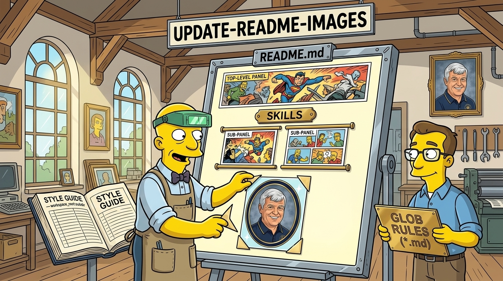

# update-readme-images



Keep a repository's visual identity consistent across its root `README.md`, package/plugin `README.md` pages, and individual `SKILL.md` files — both in `gnomatix-oss-skills` itself and in any end-user repository that adopts this skill.

Everything is driven by one configuration file (`readme-images.json`) that combines four mechanisms:
1. **Namespaced Style Guides (`workspace_root:subdir:...`)** — following the GNOMATIX hierarchical namespace SOP, so a root style guide sets the repository-wide visual language while subdirectory entries (`workspace_root:plugins:python-elimination-program`, `workspace_root:packages:ui`, etc.) inherit from the root and layer on local setting, cast, palette, and reference anchor images.
2. **Glob-Matched Rules Documents (`*`, `**`, `?`, `{a,b}`)** — binding file-path globs (`README.md`, `plugins/*/README.md`, `plugins/*/skills/*/SKILL.md`, `docs/**/*.md`) to Markdown rules documents and structured panel specifications that state **which** panel images belong in each file and **where** and **how** they are placed.
3. **Automatic `og-social-image` Invocation per `assets/images` Directory** — automatically generates and verifies a `1280×640` `< 1 MB` JPEG social preview (`<name>-og-image.jpg`) within **any** root or subdirectory using the web-standard `assets/images` layout unless explicitly disabled in `readme-images.json` or `magick` is unavailable and not installable via `mise`.
4. **Non-Destructive `assets/drafts` Staging & Asynchronous Proposed-Revision Gate** — **never** overwrites an existing image in `assets/images/` directly. Candidate replacements for existing images are staged into `<dir>/assets/drafts/` with a companion `.proposal.json` and `.proposal.md` manifest, surfaced asynchronously via `critical-control-points` and `inaudible-markup` (`[NS]{@user}`), and promoted only after explicit user approval (`--promote-draft --approved-by`).

---

## 1. The Three Supported Panel Types

### Type 1 — `top-level-panel` (Top-Level Titled Hero Panels)
- **Where used**: Immediately after the level-1 heading (`# <Title>`) in the root `README.md` (`assets/images/gnomatix-oss-skills-banner.jpg`) and in every `plugins/<plugin>/README.md` (`assets/images/<plugin>-banner.jpg`).
- **Format & aspect ratio**: `16:9` (`1376×768` standard) or `21:9`, `JPEG` (`-quality 90–92`).
- **In-scene diegetic title**: Render the repository or plugin title natively inside the scene's architecture or signage (e.g., 1980s *G.I. Joe* stencil, Westminster heraldic scroll, brass workshop sign, cosmic neon) without covering or obscuring any character's head or face.
- **Automatic `og-social-image` companion**: Every directory using `assets/images/` automatically gets `<name>-og-image.jpg` (`1280×640`, `< 1 MB`) unless disabled in config (`auto_og_social_image.enabled: false`, `style_guides[ns].og_social_image: false`, or `companion_og_image.enabled: false`).

### Type 2 — `sub-panel` (Section & Skills Sub-Panels)
- **Where used**: Inside multi-skill or multi-component `README.md` sections (`## Skills`, `## What you get`, `## Contents`, `## Config`) and at the top of individual `skills/<skill>/SKILL.md` files.
- **Examples in `gnomatix-oss-skills`**:
  - `plugins/cui-bono/README.md` (`## What you get` bullets) & `skills/{citation-farm-audit,source-provenance}/SKILL.md`: `citation-farm-audit-banner.jpg`, `source-provenance-banner.jpg`.
  - `plugins/python-elimination-program/README.md` (below `## Skills` table) & `skills/old-willy/SKILL.md`: `old-willy-computer-lab-panel.jpg`.
  - `plugins/agent-darktriad-check/README.md`: `kontentkop-badge-banner.jpg` (below `## Contents` table) and `gaslighting-meter-banner.jpg` (end of `## Config`).
  - `plugins/steering-audit-suite/README.md`: `steering-audit-suite-blueprint-banner.jpg` (immediately below `## Skills`).
- **Supported placement anchors**: `after-heading`, `after-table-in-section`, `after-bullet-matching`, `end-of-section`, and `after-h1`.

### Type 3 — `inset-oval` (Transparent-Corner Oval Inset Windows)
- **Where used**: Tribute, biography, author, or callout sections such as the Stanley Lee "Old Willy" Wilson (`1941–2022`) faculty yearbook tribute under `## Credits` in `plugins/python-elimination-program/README.md` (`assets/images/old-willy-tribute-oval.png`).
- **Mandatory technical contract**:
  - Must be a **4-channel RGBA PNG (`PNG32` / `srgba`)** — never JPEG.
  - All four exterior corners outside the oval border ring **must have `alpha == 0` (`transparent`)** so the oval window floats cleanly over light-mode, dark-mode, and callout backgrounds without rectangular boxes.
  - Interior portrait and concentric oval border ring (e.g., deep navy `#0B1F4A` outer ring + burnished gold `#D4AF37` inner trim) remain opaque (`alpha == 1`).

---

## 2. Non-Destructive Draft Staging & Asynchronous Proposed Revisions

**Hard rule: NEVER overwrite or replace any existing image in `assets/images/` directly.**

Whenever a target image already exists on disk (whether revising a hero banner, re-rendering an oval inset via `--make-oval-inset`, staging a candidate via `--stage-revision`, or running `--sync-og-images --regenerate`):

1. **Stage in `assets/drafts/`**:
   ```bash
   node plugins/update-readme-images/skills/update-readme-images/scripts/update-readme-images.mjs \
     --stage-revision /path/to/candidate.jpg plugins/<plugin>/assets/images/<plugin>-banner.jpg \
     --reason "Updated signage placement per user note"
   ```
   Because `plugins/<plugin>/assets/images/<plugin>-banner.jpg` already exists, it is **left untouched** and the candidate is written to `plugins/<plugin>/assets/drafts/<plugin>-banner.jpg` alongside `<plugin>-banner.proposal.json` and `<plugin>-banner.proposal.md`.
2. **Seek Asynchronous User Approval (Non-Blocking)**:
   - Use **`critical-control-points`**: record the single neutral decision question from `<stem>.proposal.json` (`Approve promoting this draft to <target_path>, or discard the draft?`), optionally file a Beads task (`bd create`), and **continue all unblocked work** rather than stalling the session.
   - Use **`inaudible-markup`**: surface the proposal notification using the generated CLI-safe callout line (`[workspace_root:subdir]{@user} {Request} Proposed image revision staged at ... #review #art #decision`) — never bare `@person` tokens.
   - Run **`hidden-libel-check`** and **`spank-dario`** before committing any accompanying prose or commit message (zero tool attribution).
3. **Promote or Discard Only After User Decision**:
   ```bash
   # After explicit user approval:
   node plugins/update-readme-images/skills/update-readme-images/scripts/update-readme-images.mjs \
     --promote-draft plugins/<plugin>/assets/drafts/<plugin>-banner.jpg \
     --approved-by "<verbatim quote of user's approval>"

   # Or if the user declines the candidate:
   node plugins/update-readme-images/skills/update-readme-images/scripts/update-readme-images.mjs \
     --discard-draft plugins/<plugin>/assets/drafts/<plugin>-banner.jpg
   ```
   Promotions and discards are recorded in `.claude/readme-image-approvals/log.jsonl`, and `--promote-draft` refuses to run without `--approved-by`.

---

## 3. Procedure

### Step 1 — Resolve Style Guides & Rules (`--resolve`)
Always run the CLI resolver first — never guess which style guide or rules apply:
```bash
node plugins/update-readme-images/skills/update-readme-images/scripts/update-readme-images.mjs \
  --resolve plugins/python-elimination-program/README.md
```
Read every resolved **style guide `doc`** and **rules `doc`** returned by `--resolve`.

### Step 2 — Generate Missing Panels or Stage Revisions for Existing Ones
1. **Lock visual style with `reference_images`**: pass 1–3 anchor images from the resolved namespace's `reference_images` in `ImagePaths`.
2. **Build `inset-oval` PNG32 windows**:
   ```bash
   node plugins/update-readme-images/skills/update-readme-images/scripts/update-readme-images.mjs \
     --make-oval-inset SRC.jpg plugins/<plugin>/assets/images/<name>-oval.png \
     --width 864 --height 1013 --outer-color "#0B1F4A" --inner-color "#D4AF37"
   ```
   (If `<name>-oval.png` already exists, the CLI automatically redirects output to `assets/drafts/<name>-oval.png` and emits a `.proposal.json`.)
3. **Sync automatic `og-social-image` previews across all `assets/images` directories**:
   ```bash
   node plugins/update-readme-images/skills/update-readme-images/scripts/update-readme-images.mjs \
     --sync-og-images
   ```
   If `magick` is missing and `mise` is present, install it via `mise use -g imagemagick` (per `skill-vv`); if neither is available, `--sync-og-images` degrades gracefully (`skipped_missing_tool`).

### Step 3 — Embed Missing Panels & Audit (`--apply` & `--audit --verify-images`)
```bash
node plugins/update-readme-images/skills/update-readme-images/scripts/update-readme-images.mjs --apply <file>
node plugins/update-readme-images/skills/update-readme-images/scripts/update-readme-images.mjs --audit --verify-images
```
Confirm `0` failures before claiming done, and list any pending `assets/drafts/` proposals (`--list-drafts`) awaiting user approval.

### Step 4 — Initializing in an End-User Repository (`--init`)
```bash
node plugins/update-readme-images/skills/update-readme-images/scripts/update-readme-images.mjs \
  --init /path/to/user-repo --workspace-root my-repo
```
